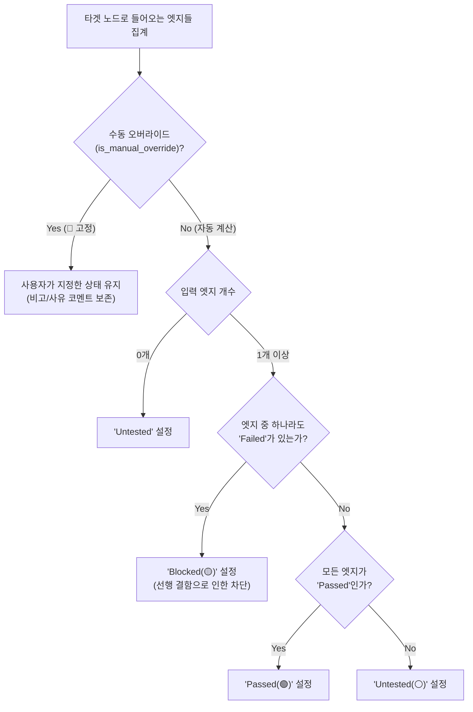
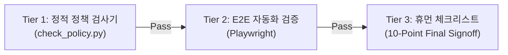

# AI Implementation Specification: CoverageMap
**Living Document & Interactive QA Test Coverage Platform**  
*Target Audience: Advanced AI Coding Agents (Gemini 4, Claude Opus 5.5, GPT-5) & Core Contributors*  
*Document Version: 2.0.0 (Living Architecture Spec)*

---

## 1. Executive Summary & Purpose (프로젝트 본질 및 목적)

### 1.1. 배경 및 미션
기존 모바일 게임 QA 프로세스는 행(Row)과 열(Column)로 구성된 선형 스프레드시트(Excel, Google Sheets)에 의존하여, 다음과 같은 구조적 한계를 안고 있었습니다:
- **비선형 화면 전환(Non-linear Transitions)**: 분기, 팝업, 뒤로가기 등 다양한 사용자 흐름을 평면적인 표에 담기 어려움.
- **공통/글로벌 횡단 관심사(Cross-cutting Concerns)**: 언어(LangKey), 사운드, 네트워크 지연 등이 여러 화면에 동시 작용할 때 발생하는 연쇄 결함을 추적하기 어려움.
- **영향도 파악(Impact Analysis) 부재**: 선행 기능이나 데이터가 변경되었을 때 어떤 후속 기능들을 다시 테스트해야 하는지 스코프(Scope) 산출이 불가능함.

**CoverageMap**은 Neo4j 그래프 데이터베이스, FastAPI(NetworkX), React Flow(@xyflow/react)를 결합하여 모바일 게임의 구조를 유기적인 그래프로 시각화하고, 실시간으로 검증 상태를 마킹·전파하는 **Living Document / Living TC Platform**입니다.

### 1.2. 차세대 AI 모델을 위한 단일 진실원천(SSOT) 선언
본 문서는 모든 AI 에이전트가 새로운 기능을 구현하거나 코드를 수정할 때 지켜야 할 **최고 권위의 개발 및 UI/UX 규격서**입니다. 본 명세서의 규칙을 어기는 코드는 머지되거나 배포될 수 없습니다.

### 1.3. 블랙박스 QA 환경 및 제로-코드 접근 정책 (Zero-Code Black-Box Constraint)
- **접근 권한 한계 규정**: CoverageMap의 핵심 타겟 환경은 **게임 클라이언트 소스 코드, 내부 리포지토리, 게임 엔진(Unity, Unreal) 프로젝트 파일에 대한 접근 권한이 전혀 없는 전형적인 퍼블리셔/외주/전담 QA의 순수 블랙박스(Black-box) 테스트 환경**입니다.
- **배제 대상 (Non-Goals)**:
  - 유니티 프리팹/언리얼 UMG 에셋 파싱, 씬 파일 역공학, 게임 클라이언트 바이너리 디컴파일.
  - 소스 코드 기반 화이트박스 정적 분석 및 소스 코드 커버리지(LCOV/JaCoCo) 계측 연동.
- **허용 및 표준 입력 소스**:
  - QA 엔지니어의 **대화형 플로우 지시(Conversational Prompt via MCP)** — `create_node`/`create_path` 등 MCP 도구로 그래프를 구성.
  - **프리셋(JSON)** — 프리셋 하나가 워크스페이스 하나에 대응하며, 프리셋 관리 화면에서 불러오기/저장.
  - 실제 구동 환경(화면, 버튼, 기능, 외부 인터랙션)에 대한 사용자 레벨의 동작 및 런타임 결과 데이터.
  - QA 엔지니어가 보유한 테스트 사양서(스프레드시트 TC)는 **MCP 대화의 참고 자료**로 활용합니다(전용 가져오기 기능 없음).
- **범위 제외 (2026-10 결정)**: 외부 LLM API를 이용한 기획서/마크다운 명세 자동 분석과 CSV 일괄 가져오기(Auto Ingest)는 프로젝트 주 목적(그래프 질의 기반 QA 코파일럿)에 비해 과설계로 판단되어 **모두 제거**되었습니다.

---

## 2. Core Architecture & Tech Stack

```mermaid
graph LR
    subgraph Data_Layer [" Data Layer (Storage) "]
        DB[(Neo4j 2026+)]
    end

    subgraph Service_Layer [" Service Layer (Logical & Algorithms) "]
        FastAPI["FastAPI (Port: 8190)"]
        NX["NetworkX (Graph Algorithms)"]
    end

    subgraph Presentation_Layer [" Presentation Layer (Interactive UI) "]
        React["React 18 + Vite"]
        RF["React Flow (@xyflow/react)"]
        ELK["ELK.js (Layered Layout)"]
    end

    subgraph Agent_Layer [" Agent & Automation Layer "]
        MCP["MCP Server (JSON-RPC)"]
        Playwright["Playwright E2E Tests"]
    end

    DB <-->|Cypher Query| FastAPI
    FastAPI <-->|In-Memory Subgraph| NX
    FastAPI <-->|REST API (/api/*)| React
    React <-->|Layouting| ELK
    React <-->|Interactive Nodes/Edges| RF
    MCP <-->|REST Wrapper| FastAPI
    Playwright -->|Browser Tests| React
```

### 2.1. 계층별 책임 분리 (Separation of Concerns)
1. **Neo4j (Data Layer)**:
   - 노드, 엣지, 프로퍼티(`name`, `label`, `aliases`, `test_status`, `is_global`, `description`, `issue_link`, `override_reason`)의 영속성 저장.
2. **NetworkX (Logical Computation)**:
   - 다중 출발지 BFS 서브그래프 추출 (`max_depth` 탐색), 루프 감지, 루트 원인 역추적(Root Cause Backtracking).
3. **React Flow & ELK.js (Presentation Layer)**:
   - 계층형 오토레이아웃(`getLayoutedElements`), 부모-자식 서브플로우 렌더링, 순수 CSS 기반 Focus+Context 딤 처리.
4. **MCP Server & E2E (Agent Layer)**:
   - AI 에이전트가 그래프를 직접 제어하고 회귀 검증을 수행하는 인터페이스.

---

## 3. Living TC State Machine & Propagation Algorithm

### 3.1. 4단계 표준 테스트 상태 (Status Taxonomy)
모든 노드와 엣지는 아래 4가지 상태 중 하나만을 가집니다:

| 상태 (Enum) | 한국어 표기 | 색상 토큰 | 의미 및 발생 조건 |
| :--- | :--- | :--- | :--- |
| **`Untested`** | 미검증 | `#64748b` (Gray) | 아직 테스트가 수행되지 않은 기본 상태 |
| **`Passed`** | 검증 완료 | `#22c55e` (Green) | 해당 기능 또는 엣지의 동작이 성공적으로 검증됨 |
| **`Failed`** | 결함 (실패) | `#ef4444` (Red) | 버그, 텍스트 오류, 기능 오작동 등으로 검증에 실패함 |
| **`Blocked`** | 차단됨 | `#f59e0b` (Amber/Yellow) | 선행 조건/엣지의 Fail로 인해 테스트를 진행할 수 없음 |

### 3.2. 상태 전파 및 합성 알고리즘 (Incoming Edge Synthesis)
타겟 노드의 상태는 해당 노드로 들어오는 모든 **입력 엣지(Incoming Edges)**의 상태를 기반으로 백엔드에서 실시간 재계산됩니다:



> **수동 오버라이드 (📌 Manual Override) 규칙**:
> - 사용자가 결함이 있는 환경에서도 특정 화면 UI를 임시 검증 완료 처리하고자 할 때 `is_manual_override: true`를 부여하고 `override_reason`(비고 사유)을 기록합니다.
> - 오버라이드된 노드는 이후 엣지가 변경되더라도 자동 합성 로직에 의해 덮어쓰기 되지 않으며, 카드에 📌 핀 아이콘이 표시됩니다.

### 3.3. 근본 원인 역추적 (Root Cause Tracing)
- 노드가 `Blocked` 또는 `Failed` 상태일 때 사용자가 **[Trace Root Cause]** 버튼을 누르면:
  - 역방향 incoming edges 중 `Failed`인 경로를 백트래킹하여 **최초 결함 발생 노드/엣지**까지 탐색합니다.
  - 해당 경로 상의 모든 노드와 엣지에 `.highlight-root-cause` CSS 클래스가 적용되어 붉은색 펄스 애니메이션 테두리로 하이라이트됩니다.

### 3.4. UI 문자열 중앙화 (단일 한국어 로케일)
UI 문자열은 `frontend/src/locales/koKR.ts` 한 곳에서 관리하며 `t`(= `I18N_LOCALES.koKR`)로 참조합니다. **한국어만 유지**하며, 영어 로케일(enUS)은 필요해지면 같은 구조의 파일을 추가해 확장합니다.

- `frontend/src` 전체(`locales/` 제외)에서 한글 UI 문자열 하드코딩이 Tier 1 규칙 6으로 차단됩니다. (주석은 허용)
- 4단계 상태 라벨은 `t.status.{Untested|Passed|Failed|Blocked}`를 사용합니다.

### 3.5. TestCase 모델링 및 연쇄 상태 전파 규격 (TestCase Modeling & State Propagation)
세부 구현 명세 및 아키텍처 배경은 **[docs/TESTCASE_MODELING_AND_STATE_PROPAGATION.md](file:///e:/Workspace/coveragemap/docs/TESTCASE_MODELING_AND_STATE_PROPAGATION.md)**를 준수합니다.
- **포함 및 검증 관계**: `Screen` (부모) ➔ `Component` (자식, `Contains`), `TestCase` ➔ `Component` (`Tests`).
- **선-후행 의존성 (`Depends_On`)**: 선행 TC가 `Failed` 또는 `Blocked`로 전이되면 후행 TC는 자동으로 `Blocked(🟡)`로 전파됩니다.
- **컴포넌트 자동 롤업**: 타겟 컴포넌트에 연결된 모든 `Tests` 관계의 TC가 `Passed`이면 컴포넌트는 `Passed(🟢)`로 자동 승격됩니다.
- **수동 차단(Manual Blocked) 지원**: 외부 요인으로 인한 차단 시 Edit Node 패널에서 수동으로 `Blocked` 지정이 가능하며 필수 사유(`override_reason`)를 기록합니다.
- **인지 부하 완화를 위한 B안(노드 내부 체크리스트) 권장**: 화면 내 수십 개 TC로 인한 그래프 폭발(Graph Clutter)을 방지하기 위해, 단순 UI 검증 항목은 캔버스 노드로 분기하지 않고 노드 내부 `properties.checklist` 속성으로 관리하며, 체크리스트 종합 결과에 따라 노드 상태가 자동 판정됩니다.

> [!NOTE]
> **구현 현황 (2026-10-11 반영 완료)**
> - **백엔드**: `backend/graph_service.py`의 순수 함수 `compute_synthesized_status` + 워크리스트 전파(`_run_propagation`). `update_node`/엣지 CRUD 직후 하류(`Depends_On`/`Tests`)로 연쇄 전파되며, 📌 고정 노드와 전역(Badge) 노드는 건너뜁니다.
> - **프론트엔드**: `frontend/src/statusPropagation.ts`가 동일 규칙을 미러링하여 낙관적으로 즉시 반영하고, 저장 후 경량 엔드포인트 `GET /api/node-statuses`(`{elementId: test_status}`)로 서버 결과와 재동기화합니다. (`/api/graph` 재조회 없음 → 레이아웃/줌 보존, Rule 3)
> - **결정 사항**:
>   1. 관계 타입은 `type(r)`로 읽고 대문자로 정규화합니다. (원 명세 5.2의 `r.type` Cypher는 동작하지 않음)
>   2. 연쇄 전파 대상은 `Depends_On`·`Tests` 두 관계뿐입니다. 화면 전환 등 Flow 엣지(`Transition`, `Contains`…)는 **엣지 자체의 상태**로만 판정하고, `Return`은 가중치 0으로 완전히 제외합니다.
>   3. `Tests` 소스 중 하나라도 `Failed`이면 대상은 `Failed`(결함 전파)이며, 이는 `Blocked`보다 우선합니다.
>   4. 입력이 `Depends_On`뿐인 노드는 선행이 정상으로 돌아오면 자신의 마킹 상태를 유지합니다(자동 `Blocked`였다면 `Untested`로 해제).
>   5. `properties.checklist`는 Neo4j에 JSON 문자열로 저장하고 API 경계에서 배열로 역직렬화합니다. 비어 있지 않은 체크리스트는 `Failed > Blocked > 모두 Passed > Untested` 순으로 노드 상태를 결정합니다.
>   6. 📌 Mark Blocked는 사유 입력이 필수이며 `is_manual_override=true`, `override_reason`을 함께 저장합니다. Mark Passed / Mark Failed / Reset Status를 누르면 고정이 해제됩니다.

---

## 4. Visual Layout & Dynamic Complexity Management

### 4.1. 부모 그룹 접기/펼치기 (Parent Collapse/Expand)
- 대규모 화면 내의 수많은 서브 기능(버튼, 팝업, 세부 UI 등 10개 이상)은 `Parent Node`로 묶입니다.
- **평소 (Collapsed)**: `isCollapsed: true` 상태에서는 하위 자식 노드들이 캔버스에서 숨겨지며, 부모 헤더에 `[ 🟢 통과: 12 / 🔴 결함: 2 (85%) ]` 형태의 프로그레스 요약 뱃지만 표시됩니다.
- **검증 시 (Expanded)**: 우측 상단의 `+` 버튼을 누르면 자식 노드들이 ELK.js 그리드 배치로 부모 컨테이너 내부에 펼쳐집니다.

### 4.2. 관점별 동적 결함 칩 (Dynamic Issue Chips)
- 현지화(LangKey), 사운드, 네트워크 지연 등 무한히 확장되는 서브카테고리는 노드 카드에 고정 테이블로 나열하지 않습니다.
- **정상 상태**: 노드 카드는 콤팩트한 기본 크기(240px x 120px)를 유지합니다.
- **결함 발생 시**: 결함이 발생한 관점만 동적으로 빨간색 알약 칩(`🏷️ [현지화: LangKey_Arena]`)으로 카드 내부에 노출됩니다.
- **Detail-on-Demand**: 칩이나 노드를 클릭하면 우측 **Inspector 패널**에서 세부 에러 내용과 연결된 테스트 케이스 전문이 표시됩니다.

### 4.3. 화면 흐름(Flow)과 리소스(Resource)의 영향도 분리
- **화면 전환 엣지(Flow Edge)**: 결함 시 다음 화면의 테스트를 완전히 `Blocked` 시킵니다.
- **리소스 뱃지(LangKey, Sound 등)**: 결함이 발생해도 화면 전환 자체는 동작하므로 다음 노드를 `Blocked`시키지 않고, 해당 노드에만 **주의(⚠️ 앰버 테두리)** 및 동적 결함 칩을 표시합니다.

### 4.4. 변경 영향도 강조 및 수정 전파 (Change Impact Ripple Highlight)
- **배경 및 목적**: 개발팀의 기획/UI 변경이 발생했을 때, 테스터가 재검증(Regression) 범위를 즉각 인지할 수 있도록 수정된 노드 및 후속 영향 경로를 시각적으로 강조합니다.
- **순수 CSS 시각 효과 (Zero-JS Styling)**:
  - 수정된 노드(`properties.is_modified: true`): `.node-modified-pulse` CSS 클래스(바이올렛 테두리 및 펄스 글로우) 및 동적 알약 칩(`✨ [Spec Updated]`).
  - 다운스트림 영향권 노드/엣지: `.highlight-affected` 스타일을 적용해 영향도 전파를 시각화.
- **테스터 라이프사이클 (Acknowledge)**:
  - 테스터가 수정 내역을 확인하고 검증을 마치면 Inspector 패널의 `[✓ 변경사항 확인 완료 (Acknowledge)]` 버튼을 통해 펄스 효과를 해제하고 정상 상태로 복귀시킵니다.
- **상세 규격 및 차기 모델(Argon / Opus 5.5) 구현 가이드**: [docs/TESTCASE_MODELING_AND_STATE_PROPAGATION.md Section 7](file:///e:/Workspace/coveragemap/docs/TESTCASE_MODELING_AND_STATE_PROPAGATION.md#7-차기-기능-명세-변경-영향도-강조-및-수정-전파-기능-change-impact-ripple-highlight)을 준수합니다.

> [!NOTE]
> **구현 현황 (2026-10-11 반영 완료)**
> - API: `POST /api/nodes/{id}/mark-modified` (body `{note}` → `is_modified=true`, `modified_note`, `modified_at`), `POST /api/nodes/{id}/acknowledge` (`is_modified=false`, `acknowledged_at`).
> - UI: Inspector의 "변경 영향도" 섹션(메모 입력 + `✨ 변경 표시` / `✓ 변경사항 확인 완료 (Acknowledge)`), 노드 카드의 `✨ [Spec Updated]` 칩 + `.node-modified-pulse`.
> - 영향권(`.highlight-affected`): 변경 노드에서 **나가는 방향, `Return` 제외, 최대 2 hop**까지의 노드/엣지를 프론트엔드에서 BFS로 계산해 CSS 클래스로만 표시합니다.
> - 결정 사항: 변경 표시/확인은 **테스트 상태를 바꾸지 않습니다.** (변경 표시 시 자동 `Untested` 리셋이나 Acknowledge 시 자동 `Passed` 처리를 하지 않음 — 재검증 결과는 테스터가 직접 마킹)

---

## 5. UI/UX Design System & Golden Rules (불변 엔지니어링 제약)

차세대 AI 모델은 코드를 작성할 때 다음의 **골든 룰(Golden Rules)**을 절대로 위반해서는 안 됩니다:

### 🌟 Rule 1: Focus+Context 순수 CSS 정책 (Zero-JS Styling)
- 노드나 엣지 컴포넌트(`CoverageNode.tsx`, `FloatingEdge.tsx`) 내에서 자바스크립트로 인라인 스타일(`style={{ opacity: 0.4 }}`)을 계산해 주입하는 행위는 **영구 금지**됩니다.
- 모든 선택, 딤, 방향성 하이라이트는 React Flow 컨테이너의 클래스 조작을 통해 순수 CSS로 제어합니다:
  - `.has-selection`: 캔버스에 선택이 활성화되었을 때 최상위에 부여.
  - `.active`: 선택된 노드 및 직간접 연관 노드 (100% 불투명).
  - `.highlight-incoming`: 진입 노드 (파란색 테두리 하이라이트).
  - `.highlight-outgoing`: 진출 노드 (주황색 테두리 하이라이트).
  - `.highlight-root-cause`: 근본 원인 경로 (빨간색 펄스 애니메이션).
  - `.has-selection .react-flow__node:not(.active)`: 비선택 노드 딤 처리 (opacity 0.4, 흑백 필터).

### 🌟 Rule 2: 12단계 표준 Z-Index 계층 체계
AI 모델은 코드에 임의의 숫자(`z-index: 99`, `z-index: 9999`)를 직접 작성할 수 없으며, 반드시 아래의 CSS 변수 토큰만을 사용해야 합니다:

```css
:root {
  --z-canvas-bg: 0;          /* 캔버스 배경 그리드 */
  --z-edge: 10;              /* 연결선 (Floating Edges) */
  --z-parent-node: 20;       /* 부모 그룹 컨테이너 */
  --z-child-node: 30;        /* 일반 자식/기능 노드 */
  --z-active-node: 40;       /* 선택/포커스된 활성 노드 및 연결 핸들 */
  --z-node-badge: 50;        /* 노드 내부 뱃지 및 액션 버튼 */
  --z-canvas-controls: 100;  /* 줌 인/아웃, 미니맵, 컨트롤 */
  --z-floating-panel: 200;   /* 우측 인스펙터 패널, 헤더 바 */
  --z-context-menu: 500;     /* 마우스 우클릭 메뉴, 드롭다운 */
  --z-tooltip: 1000;         /* 뱃지 및 인라인 툴팁 (Portal) */
  --z-loading-overlay: 2000; /* 네트워크/연산 로딩 오버레이 */
  --z-modal: 3000;           /* 워크스페이스 관리자, 모달 창 */
  --z-toast: 9999;           /* 최상위 알림 토스트 */
}
```

### 🌟 Rule 3: 낙관적 업데이트(Optimistic Update) 강제
- 상태 마킹(Pass/Fail)이나 엣지 연결/삭제 시, 백엔드 API 응답을 기다리지 않고 React 상태(`setNodes`, `setEdges`)를 즉각 업데이트해야 합니다.
- 전체 그래프 재패치(Full Refetch)를 남발하여 사용자 캔버스가 덜컹거리거나(Jumping) 줌/스크롤 위치를 잃어버리게 해서는 안 됩니다.

### 🌟 Rule 4: 포트 단일화 및 환경 변수 우선
- 기본 백엔드 포트는 `8190`입니다.
- AI 모델은 포트를 코드에 하드코딩하지 않고, `os.getenv("PORT", 8190)` 및 `process.env.BACKEND_PORT || 8190`을 통해 환경변수를 항상 최우선으로 읽어야 합니다.

### 🌟 Rule 5: 이중 영역 분리 원칙 및 순수 외곽 림 설계 (Inner Content vs Outer Rim Isolation)
단순한 매직 넘버(예: -8px)에 의존하지 않고, 인터랙션 충돌 배경과 기하학적 분리 원리를 준수해야 합니다:

#### 1. 설계 배경과 3대 충돌 요인 (Context & Root Cause)
- **arrows.app 스타일 광륜(Halo) UX**: 작은 점(10px Handle) 대신 노드 외곽 어디서나 엣지를 쉽게 드래그해 뽑아낼 수 있는 둘레 핸들 도입.
- **상충하는 3가지 사용자 의도**:
  1. 노드 내부 조작: 뱃지(✔/✖/⊘), 접기(+/-) 버튼 클릭, 텍스트 선택.
  2. 노드 이동: 노드 본체를 잡고 캔버스 내 위치 이동.
  3. 엣지 연결: 노드 테두리를 잡고 선을 뽑아냄.
- **클릭 가로채기(Click Stealing) 위험**: 핸들의 히트박스가 노드 내부 콘텐츠 영역(0px 안쪽)을 침범하면, 뱃지나 버튼 클릭 시 핸들이 이벤트를 가로채 엣지 연결 모드가 발동하거나 버튼이 씹히는 치명적 버그 발생.

#### 2. 순수 외곽 마진 원칙 (Strict Outer-Only Offset)
- **영역 분리**: 노드 본체(`custom-node`, z-index: 1 이상)는 100% 콘텐츠 조작 및 노드 이동에 할당합니다.
- **외곽 림(Outer Rim)**: 핸들(`.halo-handle`)의 히트 영역은 노드 외곽 테두리선(Border 0px 기준)으로부터 **바깥쪽으로만 균일한 완충 두께(Rim)**를 형성해야 하며, 노드 내부(0px 안쪽)로는 단 1px도 침범하지 않는 외곽 도넛 링 형태로 존재해야 합니다.
- **Z-Index 계층 보장**: 핸들의 계층은 항상 `z-index: var(--z-canvas-bg)`(0) 이하로 머물러야 하며, 노드 본체(`z-index: 1`) 및 뱃지(`--z-node-badge: 50`)보다 상위로 올라와 내부 클릭 이벤트를 덮어서는 안 됩니다.

#### 3. 드롭 타겟 핸들(Target Handle) 히트박스 및 드롭 수신 UX 개선 과제 (차기 모델 구현 과제)
- **현재 구조의 문제점 (Known Issue)**:
  - 타겟 핸들(`<Handle type="target" id="target" />`)이 `CoverageNode.tsx`에서 `top: 50%, left: 50%`, `1px x 1px`의 극소 점으로 노드 정중앙에 은닉되어 있습니다.
  - 이로 인해 사용자가 엣지를 끌어올 때 대상 노드 카드 영역이나 테두리 근처에 드롭하면 연결이 체결되지 않고, **반드시 '정중앙(50%, 50%)' 좌표까지 마우스를 밀어 넣어야만 연결되는 심각한 조작성 저하**가 발생합니다.
- **차기 모델을 위한 구현 명세 및 불변 제약조건 (Implementation Spec for Next Model)**:
  1. **광범위한 드롭 영역 확보**: 사용자가 대상 노드의 카드 영역(중앙, 모서리, 본체) 어디에 마우스를 드롭하더라도 자연스럽게 타겟 핸들로 연결이 체결되어야 합니다.
  2. **Rule 5 불변 제약 준수 (No Click Stealing)**:
     - 평상시(Idle)에는 노드 내부의 버튼/뱃지(✔/✖/⊘), 접기(+/-) 버튼 클릭 이벤트 및 노드 드래그(Pan)를 절대로 가로채지 말아야 합니다.
     - React Flow의 연결 드래그 진행 상태(예: `.react-flow--connecting` 상태 클래스 또는 연결 진행 플래그)를 활용하여, 연결 중일 때만 타겟 핸들의 히트박스를 노드 전역(`inset: 0` 등)으로 확장하거나 드롭 타겟 포인터 이벤트를 활성화하는 방식을 적용합니다.
  3. **검증 기준 통과 보장**:
     - `python scripts/check_policy.py` (Tier 1 정적 정책 검사 통과)
     - `cd backend; uv run pytest -q` 및 `cd e2e-tests; npm test` (기존 엣지 생성/삭제/뱃지 클릭 테스트 전원 통과)

> [!NOTE]
> **구현 현황 (2026-10-11 반영 완료)**: 타겟 핸들에 `className="target-drop-handle"`을 부여하고(`CoverageNode.tsx`), `index.css`에서
> - 평상시: 중앙 1px 점 + `pointer-events: none` + `z-index: var(--z-canvas-bg)` → 내부 클릭을 절대 가로채지 않음
> - `.react-flow--connecting` 상태(`App.tsx`의 `onConnectStart`/`onConnectEnd`로 루트에 부여): `inset 0` 전체 크기 + `pointer-events: all` + `z-index: var(--z-active-node)` → 카드 어디에 놓아도 연결
> - 자기 자신으로의 연결은 `isValidConnection`으로 차단합니다.

### 🌟 Rule 6: 단일 부모 트리 제약, 부모 노드 스케일 불변 및 클린 라이트 테마 표준 (Parent Constraints & Light Theme)

#### 1. 단일 부모 트리 제약 (Single Parent Constraint)
- 2D 시각적 평면 캔버스(Subflow)에서 하나의 자식 노드는 **물리적으로 오직 1개의 부모 노드에만 속할 수 있습니다 (in-degree(CONTAINS) <= 1).**
- 여러 부모가 공통으로 참조해야 하는 다대다 기능(공통 팝업, 세션 모듈, 네트워크 에러 처리 등)은 특정 부모 내부에 가두지 않고, 독립 리프 노드로 배치하여 화살표(Edge)로 연결하거나 **동적 뱃지 칩(`Dependencies Badge Pills`)**으로 흡수합니다.

#### 2. 물리적 중첩 깊이 제한 (Max Nesting Depth = 1) 및 반복 관심사 체크박스화
- 캔버스 박스 인 박스(Subflow)의 물리적 중첩은 **최대 1단계(부모 ➔ 자식)**로 엄격히 제한합니다 (`Depth > 1` 금지).
- 다국어(Localization), 플랫폼(AOS/iOS), 사운드 On/Off 등 반복되는 횡단 관심사는 새로운 자식 노드로 분기시키지 않고, **노드 내부의 속성 체크리스트(Checklist) 또는 동적 이슈 칩(Dynamic Chips)**으로 평탄화(Flattening)하여 그래프 폭발을 방지합니다.

#### 3. 부모 노드 스케일 불변 원칙 (Parent Immutable Scale)
- 자식 노드들을 품고 있는 부모 노드는 내부 2차원 기준 좌표계의 원점(Origin)이므로, 선택(`active`)되거나 호버되어도 **`transform: scale`을 1px도 변경해서는 안 됩니다.**
- 부모 노드의 선택 강조는 오직 **`box-shadow`(외곽 포커스 링)와 `border-color`로만 표현**하며, CSS 선택자는 반드시 직계 자식(`>`)으로 한정하여 자식 노드로의 스타일 누수(Bleeding)를 원천 차단합니다.

#### 4. 엔터프라이즈 클린 라이트 테마 표준 (Clean Light Theme Default)
- 장시간 테스트 케이스 검토와 QA 실무 가독성을 위해, 시스템의 기본 테마는 **Miro / Linear 스타일의 산뜻하고 눈이 편안한 밝은 톤(Clean Light Theme)**을 기본값으로 채택합니다.
- 배경 그리드는 연회색 도트, 노드는 순백색 카드(#ffffff)와 미세 테두리(#cbd5e1), 텍스트는 선명한 흑청색(#0f172a), 상태 뱃지는 부드러운 파스텔 톤을 적용합니다.

---

## 6. 3-Tier Quality Verification Pipeline (품질 검증 게이트)

AI 모델이 코드 작업을 완료하면 반드시 아래 3단계 게이트를 거쳐야 합니다:



### Tier 1: 정적 정책 검사기 (Static Policy Checker)
- 실행 명령: `python scripts/check_policy.py`
- 자동 검출 항목:
  1. CSS 및 TSX 내 하드코딩된 숫자 z-index(`z-index: \d{2,}`) 사용 여부 (CSS 토큰 강제).
  2. TSX 파일 내 인라인 `opacity` 조작 여부 (CSS Focus+Context 강제).
  3. 구버전 포트 `8001` 잔존 여부 (`8190` 및 환경변수 사용 강제).
  4. `.halo-handle`의 z-index가 `var(--z-canvas-bg)`(0) 이하인지 (Halo 핸들 격리).
  5. E2E의 모든 `test.skip`/`test.fixme` 바로 윗줄에 `// SKIP-REASON: <사유>` 주석이 있는지.
  6. `frontend/src`(`locales/` 제외)에 한글 UI 문자열 하드코딩이 없는지.

### Tier 2: 자동화 테스트 (pytest + Playwright)
- 백엔드 단위 테스트: `cd backend; uv run pytest -q` (실패 0건 필수. 수동 실행용 `test_e2e*.py`는 `conftest.py`에서 수집 제외)
- E2E: `cd e2e-tests; npm test` (실패 0건 필수. skip은 Tier 1 규칙 5의 사유 주석이 있어야 함)
- 완료 보고에는 실제 로그의 passed/failed/skipped 수치를 그대로 인용합니다.
- 캔버스 렌더링, 딤 클래스 부여 여부, 노드/엣지 CRUD, 툴팁 표시 및 오버랩 방지 검증.

### Tier 3: 휴먼 체크리스트 (Human-in-the-loop 10개 항)
1. [ ] 부모 노드를 접었을 때 하위 노드들이 캔버스에서 가려지고 요약 프로그레스 바가 뜨는가?
2. [ ] 노드를 클릭했을 때 주변 비연관 노드들이 순수 CSS에 의해 40% 투명도로 딤 처리되는가?
3. [ ] 툴팁이나 우측 패널이 다른 노드 뒤로 숨겨지지 않고 올바른 Z-Index 계층 위에 뜨는가?
4. [ ] 엣지가 Failed일 때 연결된 후속 노드가 자동으로 `Blocked(🟡)`로 전파되는가?
5. [ ] 수동 오버라이드 시 사유 코멘트(비고)를 입력할 수 있고 📌 핀 아이콘이 유지되는가?
6. [ ] Root Cause 추적 버튼을 눌렀을 때 최초 결함 원인까지 붉은색 펄스 애니메이션이 이어지는가?
7. [ ] UI 문자열이 `frontend/src/locales/koKR.ts`(`t`)를 통해 일관되게 표시되는가?
8. [ ] 상태 마킹 시 화면 레이아웃이 덜컹거리거나 줌 배율이 초기화되지 않는가?
9. [ ] 포트 8190 및 환경변수가 올바르게 연동되어 통신 실패가 발생하지 않는가?
10. [ ] `python scripts/check_policy.py`가 에러 없이 0으로 종료되는가?
