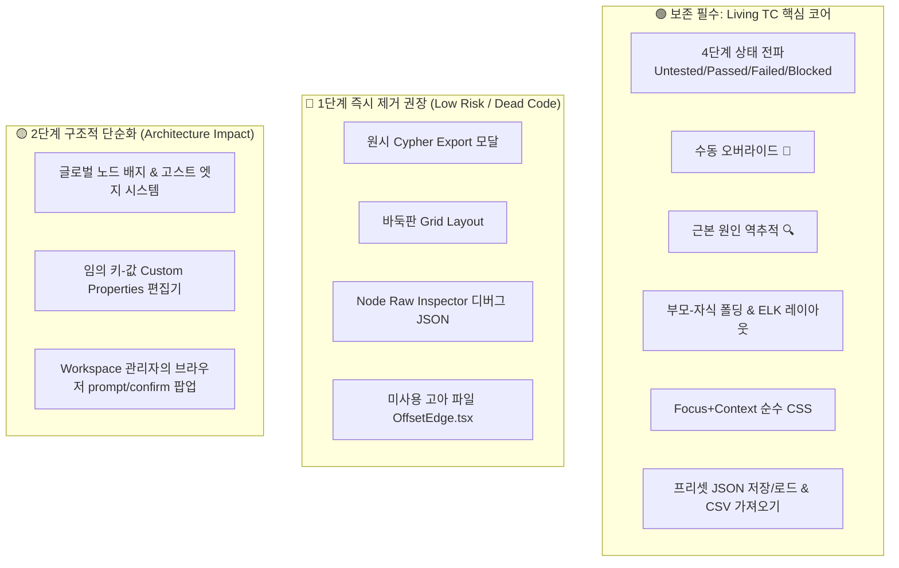

# CoverageMap 기능 경량화 및 최소 핵심 기능 가이드 (Feature Pruning Guide)

본 문서는 **새로운 테스트 방법론 도입**을 위해 CoverageMap 플랫폼을 순수 핵심 기능 위주로 슬림화하고, 다음 작업자가 안전하고 일관성 있게 불필요한 기능을 정리할 수 있도록 분류 및 작업 지침을 정리한 공식 인수인계 문서입니다.

단일 진실원천인 **SSOT (`AI_IMPLEMENTATION_SPEC.md`, `UI_UX_DESIGN_SYSTEM.md`, `AGENTS.md`)**에 규정된 비전 및 블랙박스 QA 제약 원칙을 기준으로 작성되었습니다.

---

## 1. 개요 및 목적 (Background & Objectives)

CoverageMap은 비선형적인 모바일 게임 QA 프로세스를 그래프 기반 Living TC(Living Document)로 시각화하는 도구입니다. 그동안 프로토타이핑과 다양한 기능 실험을 거치며 편의성 기능 및 디버그용 인터페이스가 누적되었습니다.

새로운 테스트 방법론을 빠르고 안정적으로 도입하기 위해서는, **Living TC 플랫폼의 본질적 가치(그래프 시각화, 4단계 상태 전파, 근본 원인 추적, Focus+Context)만 남기고 주변부 기능을 정돈**하여 프론트엔드(`App.tsx`)와 백엔드의 복잡도를 대폭 낮추는 작업이 필요합니다.



---

## 2. 영구 보존할 절대 핵심 기능 (Core Invariants)

새로운 테스트 방법론 도입 시에도 **절대로 훼손하지 않고 온전히 유지해야 하는 핵심 요소**:

| 기능 영역 | 보존 항목 | SSOT 규격 근거 | 비고 |
| :--- | :--- | :--- | :--- |
| **상태 머신 (Taxonomy)** | 4단계 상태 (`Untested`, `Passed`, `Failed`, `Blocked`) 및 입력 엣지 기반 자동 상태 합성(Propagation) | SSOT 3.1, 3.2 | 비선형 QA의 핵심 검증 엔진 |
| **수동 예외 처리** | 수동 오버라이드 (📌 Manual Override) 및 사유 코멘트(`override_reason`) 보존 | SSOT 3.2 | 자동 합성 덮어쓰기 방지 |
| **추적성 (Tracing)** | 결함 발생 시 최초 원인까지 역방향 백트래킹 및 붉은 펄스 애니메이션 (`Root Cause Tracing`) | SSOT 3.3 | 블로커 및 결함 발생 경로 추적 |
| **계층 구조 (Subflow)** | 부모-자식 노드 포함 관계(`CONTAINS`), Collapse/Expand(`+/-`) 및 요약 프로그레스 | SSOT 4.1, 5 Rule 6 | 단일 부모 제약 및 Max Depth=1 준수 |
| **순수 CSS 시각화** | Focus+Context 관계 하이라이트 (선택 노드 Focus, 비선택 노드 40% Dimmed, 진입 Blue, 진출 Orange) | SSOT 5 Rule 1 | Zero-JS Styling, 12단계 Z-Index 준수 |
| **핸들 조작성 (Halo UX)** | 노드 외곽 둘레 도넛 링 핸들 (`.halo-handle`, Z-Index 0 이하 격리) | SSOT 5 Rule 5 | 클릭 가로채기(Click Stealing) 방지 |
| **안전한 영속성** | 프리셋 저장/불러오기 (`Preset JSON`, 트랜잭션 보장, 자동 백업 `_autobackup_*`) 및 CSV 수집 | SSOT 1.3, 2.1 | 블랙박스 QA 표준 입력/저장 방식 |

---

## 3. 1단계: 즉시 제거 권장 기능 (Tier 1: Low Risk / Cleanup)

비즈니스 로직에 악영향을 주지 않으며, SSOT 규격 원칙에 부합하지 않거나 이미 더 우수한 메커니즘으로 대체된 기능들입니다.

### 3.1. 원시 Cypher 내보내기 (`Export Cypher`)
- **위치**: `frontend/src/App.tsx` 내 `generateCypher`, `showCypherExport`, 상단 툴바 버튼
- **제거 사유**: 
  - SSOT 1.3장(블랙박스 QA 제로-코드 정책)에 명시된 대로 QA 엔지니어는 데이터베이스 쿼리에 접근하지 않습니다.
  - 이미 안전한 트랜잭션과 자동 백업(`_autobackup_*`)을 지원하는 **Preset (JSON) 저장/불러오기**가 완비되어 있으므로 완전 중복입니다.

### 3.2. 바둑판 그리드 정렬 (`🗂 Grid Layout`)
- **위치**: `frontend/src/App.tsx` 툴바 버튼, `frontend/src/layout.ts` 내 `getGridLayoutedElements`
- **제거 사유**:
  - CoverageMap의 본질은 "엣지(흐름) 기반의 비선형 의존성 시각화"입니다.
  - 단순 4열 그리드 정렬은 엣지 방향성과 계층 구조를 완전히 무시하고 노드를 흩뿌려 선이 꼬이는 스파게티 현상을 초래합니다.
  - 이미 엣지 방향과 그룹 계층을 완벽히 계산하는 **ELK.js 계층형 오토레이아웃(`⟳ Re-layout`)**으로 단일화하는 것이 바람직합니다.

### 3.3. 노드 원시 JSON 인스펙터 (`🔍 Node Raw Inspector (Debug)`)
- **위치**: `frontend/src/App.tsx` 우측 Edit 탭 하단 `<details>` 블록
- **제거 사유**:
  - 초기 개발 시 내부 메타데이터 디버깅용으로 삽입된 JSON 덤프 뷰입니다.
  - 상단 폼 컨트롤(이름, 라벨, 카테고리, 상태 등)에서 모든 편집이 제공되므로 실무 테스터에게는 시각적 노이즈에 불과합니다.

### 3.4. 미사용 고아 컴포넌트 (`frontend/src/OffsetEdge.tsx`)
- **위치**: `frontend/src/OffsetEdge.tsx`
- **제거 사유**:
  - `FloatingEdge.tsx`로 단일화되어 프로젝트 어디에서도 import되거나 등록되지 않은 완전한 죽은 코드(Dead Code)입니다.

---

## 4. 2단계: 구조적 단순화 검토 (Tier 2: Architecture Simplification)

새로운 테스트 방법론의 데이터 모델 및 워크플로우에 맞춰 제거 또는 대폭 단순화를 검토할 수 있는 항목들입니다.

### 4.1. 글로벌 노드 배지 & 호버 고스트 엣지 / Impact Overlay 시스템
- **위치**: `frontend/src/App.tsx` (`rightPanelTab === 'globals'`, `hoveredGlobalBadgeId`, `impactMode` 등), `frontend/src/CoverageNode.tsx` (`node-badges-section`, `badge-pill` 등)
- **현황 및 문제점**:
  - 우측 패널에서 글로벌 노드를 생성하여 일반 노드 카드 내부에 의존성 알약(Pill Badge)으로 부착합니다.
  - 배지 마우스 호버 시 캔버스 중앙에 임시 노드를 배치하고 가상 점선 엣지(`hover-edge-...`)를 렌더링하며, 하단에 `Impact Overlay Stats Bar`를 표시합니다.
  - 이 과정에서 커스텀 윈도우 이벤트(`selectBadgeNode`, `markBadgeStatus`, `hoverGlobalBadge`)와 임시 노드/엣지 오버라이드가 다수 발생하여 `App.tsx`와 `CoverageNode.tsx`의 렌더링 복잡도를 크게 높이고 있습니다.
- **단순화 방향 (SSOT 권장)**:
  - SSOT 4.2장 및 5장 Rule 6에 따르면, 횡단 관심사(다국어, 사운드 등)는 무거운 별도 노드 엔티티 대신 **단순 속성 체크리스트 또는 동적 이슈 칩(Dynamic Issue Chips)**으로 평탄화(Flattening)하도록 규정되어 있습니다.
  - 새로운 방법론에서 복잡한 글로벌 엔티티 연동이 불필요하다면, 고스트 엣지 및 배지 핀 오버레이를 걷어내고 단순 칩/태그 형태로 일원화할 수 있습니다.

### 4.2. 임의의 키-값 동적 속성 편집기 (`Custom Properties`)
- **위치**: `frontend/src/App.tsx` 우측 Edit 탭 내 `SYSTEM_RESERVED_KEYS` 제외 프로퍼티 편집 UI
- **단순화 방향**:
  - 새로운 테스트 방법론이 정형화된 테스트 케이스 스키마를 요구한다면, 임의의 key-value 추가 기능을 제거하고 고정 필드(`name`, `label`, `aliases`, `test_status`, `description`, `issue_link`)로 고정하여 데이터 정규성을 높일 수 있습니다.

### 4.3. 워크스페이스 관리자 모달 내 브라우저 팝업 편집
- **위치**: `frontend/src/App.tsx` 내 `showWorkspaceManager` 모달
- **단순화 방향**:
  - 브라우저 네이티브 `prompt()` / `confirm()` 기반의 전역 별칭 일괄 수정/삭제는 예기치 않은 데이터 변조 위험이 있습니다.
  - 워크스페이스는 단순한 필터링/시작화면 선택 UI만 남기고, 무거운 인라인 편집 모달은 축소할 수 있습니다.

---

## 5. 다음 작업자를 위한 단계별 실행 지침 (Implementation Guide)

1단계(즉시 제거 권장)를 작업할 때 다음 순서대로 진행합니다:

### Step 1. 파일 삭제
- `frontend/src/OffsetEdge.tsx` 삭제

### Step 2. `frontend/src/layout.ts` 정리
- `getGridLayoutedElements` 함수 삭제 (ELK `getLayoutedElements`만 단일 유지)

### Step 3. `frontend/src/App.tsx` 정리
1. **Cypher Export 관련 제거**:
   - `generateCypher` 함수 제거
   - `showCypherExport`, `cypherQuery` useState 제거
   - 상단 툴바의 `<button ...>Export Cypher</button>` JSX 제거
   - 하단의 `{showCypherExport && (...)}` 모달 JSX 제거
2. **Grid Layout 관련 제거**:
   - 상단 툴바의 `<button ...>🗂 Grid Layout</button>` JSX 제거
   - `getGridLayoutedElements` import 제거
3. **Node Raw Inspector 관련 제거**:
   - Edit 탭 하단의 `<details>...🔍 Node Raw Inspector (Debug)...</details>` JSX 제거

### Step 4. `frontend/src/locales/koKR.ts` 동기화
- 제거된 기능과 연관된 번역 키(`toolbar.exportCypher`, `toolbar.cypherCopied`, `toolbar.gridLayout` 등) 정리

### Step 5. 무결성 및 정책 검증
작업 완료 후 반드시 3-Tier 검증 파이프라인의 기준을 통과해야 합니다:
```bash
# 1. Tier 1 정적 정책 검사 (반드시 exit code 0)
python scripts/check_policy.py

# 2. TypeScript 정적 컴파일 검사 (타입/임포트 에러 0건)
cd frontend && npx tsc --noEmit
```
