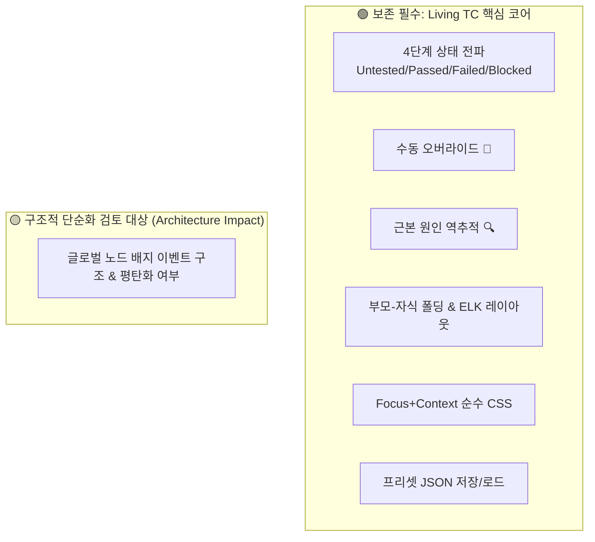

# CoverageMap 기능 경량화 및 최소 핵심 기능 가이드 (Feature Pruning Guide)

본 문서는 **새로운 테스트 방법론 도입**을 위해 CoverageMap 플랫폼을 순수 핵심 기능 위주로 슬림화하고, 다음 작업자가 안전하고 일관성 있게 불필요한 기능을 정리할 수 있도록 분류 및 작업 지침을 정리한 공식 인수인계 문서입니다.

단일 진실원천인 **SSOT (`AI_IMPLEMENTATION_SPEC.md`, `UI_UX_DESIGN_SYSTEM.md`, `AGENTS.md`)**에 규정된 비전 및 블랙박스 QA 제약 원칙을 기준으로 작성되었습니다.

---

## 1. 개요 및 목적 (Background & Objectives)

CoverageMap은 비선형적인 모바일 게임 QA 프로세스를 그래프 기반 Living TC(Living Document)로 시각화하는 도구입니다. 그동안 프로토타이핑과 다양한 기능 실험을 거치며 편의성 기능 및 디버그용 인터페이스가 누적되었습니다.

새로운 테스트 방법론을 빠르고 안정적으로 도입하기 위해서는, **Living TC 플랫폼의 본질적 가치(그래프 시각화, 4단계 상태 전파, 근본 원인 추적, Focus+Context)만 남기고 주변부 기능을 정돈**하여 프론트엔드(`App.tsx`)와 백엔드의 복잡도를 대폭 낮추는 작업이 필요합니다.



---

## 2. 영구 보존할 절대 핵심 기능 (Core Invariants)

새로운 테스트 방법론 도입 시에도 **절대로 훼손하지 않고 온전히 유지해야 하는 핵심 요소**:

| 기능 영역 | 보존 항목 | SSOT 규격 근거 | 비고 |
| :--- | :--- | :--- | :--- |
| **상태 머신 (Taxonomy)** | 4단계 상태 (`Untested`, `Passed`, `Failed`, `Blocked`) 및 입력 엣지 기반 자동 상태 합성(Propagation) | SSOT 3.1, 3.2 | 비선형 QA의 핵심 검증 엔진 |
| **수동 예외 처리** | 수동 오버라이드 (📌 Manual Override) 및 사유 코멘트(`override_reason`) 보존 | SSOT 3.2 | 자동 합성 덮어쓰기 방지 |
| **추적성 (Tracing)** | 결함 발생 시 최초 원인까지 역방향 백트래킹 및 붉은 펄스 애니메이션 (`Root Cause Tracing`) | SSOT 3.3 | 블로커 및 결함 발생 경로 추적 |
| **계층 구조 (Subflow)** | 부모-자식 노드 포함 관계(`CONTAINS`), Collapse/Expand(`+/-`) 및 요약 프로그레스 | SSOT 4.1, 5 Rule 6 | 단일 부모 제약 및 Max Depth=1 준수 |
| **순수 CSS 시각화** | Focus+Context 관계 하이라이트 (선택 노드 Focus, 비선택 노드 40% Dimmed, 진입 Blue, 진출 Orange) 및 특정 콘텐츠 포커스 고정(`📌`) | SSOT 5 Rule 1 | Zero-JS Styling, 12단계 Z-Index 준수 |
| **핸들 조작성 (Halo UX)** | 노드 외곽 둘레 도넛 링 핸들 (`.halo-handle`, Z-Index 0 이하 격리) | SSOT 5 Rule 5 | 클릭 가로채기(Click Stealing) 방지 |
| **안전한 영속성** | 프리셋 저장/불러오기 (`Preset JSON`, 트랜잭션 보장, 자동 백업 `_autobackup_*`) | SSOT 1.3, 2.1 | 블랙박스 QA 표준 입력/저장 방식 |

---

## 3. 구조적 단순화 검토 대상 (Architecture Simplification Backlog)

데이터 모델 및 QA 워크플로우 고도화에 맞춰 사용자 의사결정 후 제거 또는 단순화를 검토할 수 있는 미결 항목들입니다.

### 3.1. 글로벌 노드 배지 커스텀 이벤트 구조 및 평탄화 범위
- **위치**: `frontend/src/App.tsx` (`rightPanelTab === 'globals'`, `impactMode`), `frontend/src/CoverageNode.tsx` (`node-badges-section`, `badge-pill`)
- **검토 포인트**:
  - 배지 선택 및 상태 변경 시 사용되는 커스텀 윈도우 이벤트(`selectBadgeNode`, `markBadgeStatus`)를 React Context 또는 콜백 prop으로 일원화할지 여부.
  - SSOT 4.2장 및 5장 Rule 6에 따라, 횡단 관심사(다국어, 사운드 등)를 현행 전역 노드 배지(`is_global: true`) 방식으로 유지할지, 혹은 노드 내부 속성/동적 이슈 칩으로 더 단순화할지 여부.

---

## 4. 작업 시 무결성 및 정책 검증 기준 (Verification Gate)

위 구조적 단순화 항목을 실행할 때에는 작업 완료 후 반드시 3-Tier 검증 파이프라인을 통과해야 합니다:
```bash
# 1. Tier 1 정적 정책 검사 (반드시 exit code 0)
python scripts/check_policy.py

# 2. TypeScript 정적 컴파일 검사 (타입/임포트 에러 0건)
cd frontend && npx tsc --noEmit

# 3. Tier 2 백엔드 및 E2E 테스트
cd backend && uv run pytest -q
cd e2e-tests && npm test
```

