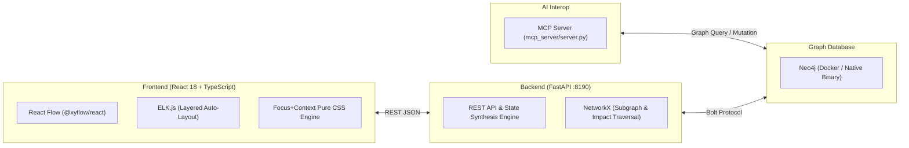

# CoverageMap

**CoverageMap**은 모바일 게임 QA 프로세스의 비선형적(Non-linear) 상태 구조를 상호작용 가능한 그래프로 시각화하고 검증하는 **Living Document Platform**입니다. 기존의 선형적인 스프레드시트 기반 테스트케이스(TC)가 가지는 구조적 한계—결함 파급 범위 추적 불가, 기획 변경 시 회귀 범위 산정 병목, 중복 TC 유지보수 비용—를 그래프 상태 기계(Graph State Machine)로 해결합니다.

---

## 1. 배경 및 문제 정의 (Why CoverageMap?)

모바일 게임은 메인 로비를 중심으로 상점, 던전, 영웅 성장, 인벤토리, 팝업 등이 그물망처럼 얽혀 있는 **비선형 상태 그래프**입니다. 이를 1차원 표(스프레드시트)로만 관리할 때 다음과 같은 실무 병목이 발생합니다.

1. **선행 결함에 따른 연쇄 차단(Blocked) 파악 불가**: 특정 진입점이나 선행 기능이 실패(`Failed`)했을 때, 이로 인해 테스트가 불가능해지는 하위 기능들을 표에서 수동으로 찾아 상태를 변경해야 합니다.
2. **기획 변경 시 회귀 테스트(Regression) 범위 산정의 모호함**: 특정 화면이나 데이터 스펙이 변경되었을 때, 그 변경이 몇 단계 건너편의 어떤 콘텐츠까지 영향을 미치는지 즉각적으로 파악하기 어렵습니다.
3. **횡단 관심사(Cross-Cutting Concerns)의 파편화**: 다국어(L10N), 네트워크 단절, 사운드, 재화 공급/소비(`Gold`, `Gem`)처럼 수십 개 화면에 동시에 걸치는 검증 항목을 스프레드시트마다 중복 작성하게 됩니다.

---

## 2. 핵심 설계 철학 (Core Philosophy)

CoverageMap은 기능 추가나 UI 변경에도 흔들리지 않는 4가지 불변의 모델링 원칙을 기반으로 동작합니다.

### ① Black-Box QA 환경 전제 (Zero-Code Access)
게임 클라이언트 소스코드나 엔진 프로젝트(Unity, Unreal)에 접근할 수 없는 순수 블랙박스 QA 환경을 전제로 설계되었습니다. 모든 그래프 구조와 검증 포인트는 기획/테스트 산출물 및 AI 에이전트(MCP)와의 대화를 통해 구축됩니다.

### ② Room-Door-Furniture 3계층 모델링 분리
그래프의 과도한 중첩과 복잡도 폭발을 막기 위해 검증 대상을 3가지 계층으로 엄격히 분리합니다 (`Max Depth = 1` 원칙).
* **방 (Node — Context/Screen/Component)**: 유저가 머무르는 화면, 모달, 주요 기능 단위.
* **문 (Edge — Action/Transition)**: 화면 간 이동이나 의존 관계 (`Transition`, `Depends_On`, `Contains`, 그리고 순환 참조 데드락을 방지하는 가중치 0의 역방향 귀환 간선 `Return`).
* **가구 (Checklist — Static Specs)**: 단순 버튼 노출, 텍스트, 딤(Dimmed) 처리 등 정적 UI 스펙은 별도 노드로 쪼개지 않고 **노드 내부 체크리스트**로 흡수하여 그래프 가독성을 보존합니다.

### ③ Living TC 4단계 상태 자동 전파 및 원인 역추적
* 모든 요소는 `Untested` (⚪), `Passed` (🟢), `Failed` (🔴), `Blocked` (🟡) 4단계 상태를 가집니다.
* 선행 노드에 결함(`Failed`)이 발생하면 의존성을 가진 하류 노드들이 자동으로 `Blocked` 상태로 전환되며, **원인 역추적(Root Cause Tracing)**을 통해 최초 결함 지점까지의 경로를 즉시 시각화합니다.
* 기획/스펙이 변경된 노드는 **변경 영향도 파동(Change Impact Ripple)**을 통해 하류 의존 경로(최대 2-Hop)에 재검증 필요 신호를 전파합니다.

### ④ 전역 노드(Global Node)와 논리 도메인 분리
* 다국어, 네트워크, 재화 흐름 등 모든 화면에 걸치는 횡단 관심사는 캔버스를 가로지르는 간선 대신 **전역 배지(Global Badge)**와 **다중 Impact 오버레이(OR/AND 필터 및 격리 뷰)**로 관리합니다.
* 물리적 컨테이너 중첩(`Depth = 1`)을 유지한 채 `전투`, `성장`, `상점`, `소셜`, `시스템` 등 논리적 최상위 도메인 단위로 그래프를 즉시 필터링·격리 탐색할 수 있습니다.

---

## 3. 시스템 아키텍처 (Tech Stack)



* **Data Layer**: Neo4j (Docker 컨테이너 및 Windows 네이티브 바이너리 이중 환경 지원)
* **Backend**: Python, FastAPI (표준 포트 `8190`), NetworkX, `uv`
* **Frontend**: React 18, `@xyflow/react`, ELK.js, Vite, TypeScript
* **AI Agent Interop**: Model Context Protocol (`mcp_server/server.py`)
* **Verification**: 3-Tier 검증 파이프라인 (`scripts/check_policy.py` 정적 정책 검사 + Pytest + Playwright E2E)

---

## 4. 실행 방법 (Quick Start)

### 1) 데이터베이스 실행 (Neo4j)
프로젝트 루트의 `run_db.bat`을 실행하면 시스템 환경변수(`NEO4J_HOME`), `PATH`, 또는 로컬 드라이브의 Neo4j를 자동 감지하여 기동합니다. (Docker 사용 시 아래 명령어로 실행 가능)
```powershell
docker compose up -d neo4j
```

### 2) 백엔드 실행 (FastAPI, Port `8190`)
프로젝트 루트의 `run_backend.bat`을 실행하거나 아래 명령어를 입력합니다.
```powershell
cd backend
uv run uvicorn main:app --reload --port 8190
```

### 3) 프론트엔드 실행 (React + Vite)
```powershell
cd frontend
npm run dev
```

### 4) 검증 파이프라인 실행 (Tests & Policy Check)
```powershell
# Tier 1: 아키텍처/스타일/다국어 정적 정책 검증
python scripts/check_policy.py

# Tier 2: 백엔드 단위 테스트 및 E2E 테스트
cd backend && uv run pytest -q
cd e2e-tests && npm test
```

---

## 5. 문서 가이드 (Documentation Index)

세부 구현 규격과 버전별 기능 변경 이력은 아래 문서에서 관리됩니다.

* **[AI_IMPLEMENTATION_SPEC.md](AI_IMPLEMENTATION_SPEC.md)**: 상태 전파 규칙, Z-Index 12단계 토큰, Focus+Context CSS 정책 등 핵심 불변 명세 (SSOT)
* **[UI_UX_DESIGN_SYSTEM.md](UI_UX_DESIGN_SYSTEM.md)**: 컬러 시스템, 노드/간선 시각 계층 및 인터랙션 디자인 가이드
* **[docs/TESTCASE_MODELING_AND_STATE_PROPAGATION.md](docs/TESTCASE_MODELING_AND_STATE_PROPAGATION.md)**: 3계층 모델링 가이드 및 상태 합성/전파 상세 명세
* **[docs/GLOBAL_IMPACT_ISOLATION_AND_NAVIGATION_SPEC.md](docs/GLOBAL_IMPACT_ISOLATION_AND_NAVIGATION_SPEC.md)**: 전역 노드 영향도 격리 뷰 및 네비게이터 명세
* **[docs/PROPOSAL_TAG_BASED_DOMAIN_GROUPING.md](docs/PROPOSAL_TAG_BASED_DOMAIN_GROUPING.md)**: 논리 도메인 그룹핑 및 퀵 격리 탐색 명세
* **[CHANGELOG.md](CHANGELOG.md)**: 버전별 주요 기능 추가 및 버그 수정 이력

---

## 6. 라이선스 (License)

이 프로젝트는 [MIT License](LICENSE) 하에 배포됩니다.
