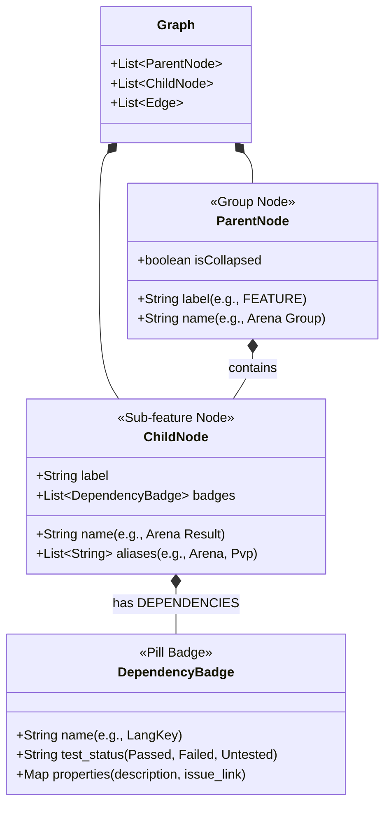
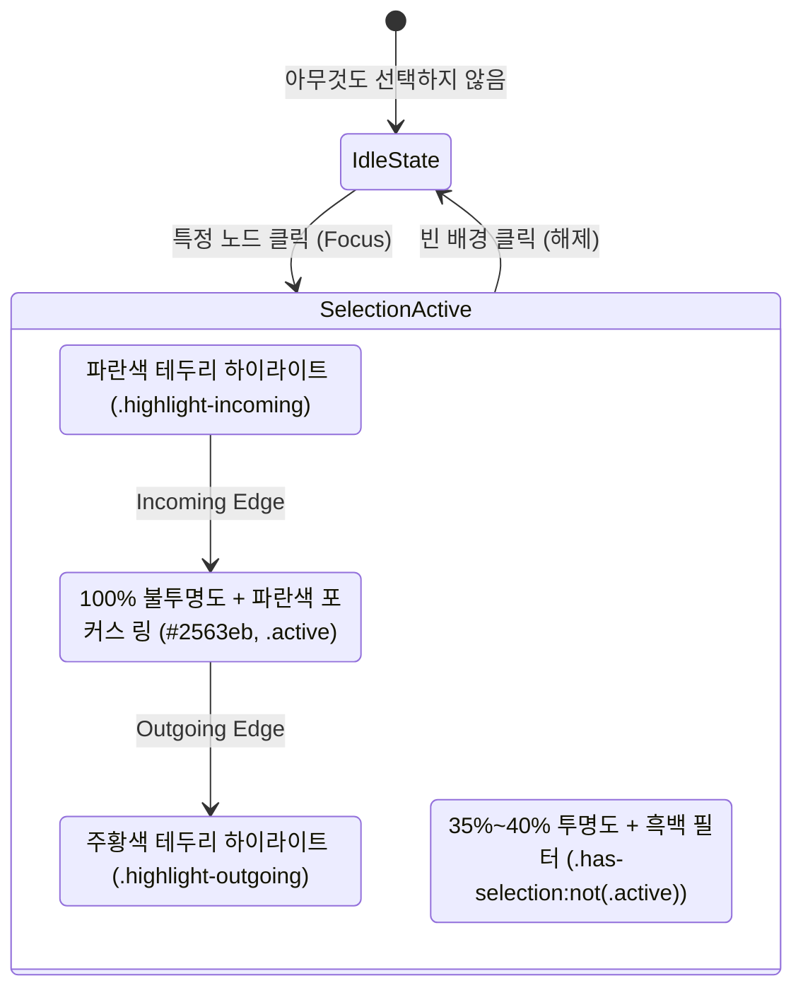

# CoverageMap UI/UX Design System & Layout Policy

이 문서는 CoverageMap(비선형적 모바일 게임 QA 프로세스 시각화 도구)의 인수인계를 위해, UI 컴포넌트 명칭과 레이아웃 정책(Focus + Context 등)을 모델링하고 시각화한 가이드입니다.
프로젝트의 목적(Test Scope 파악 및 Test Coverage 시각화)에 부합하도록 일관성 있는 UI를 유지하는 것이 핵심입니다.

## 1. UI 컴포넌트 구조 및 명칭 (Naming Convention)

UI 요소와 데이터 모델 간의 혼동을 막기 위해 아래의 명칭을 표준으로 사용합니다.

- **Parent Node (Group Node)**:
  - 여러 하위 기능을 묶는 거대한 컨테이너 노드입니다. (예: `Arena Group`)
  - 우측 상단에 Collapse/Expand(`+/-`) 버튼이 존재하여 접고 펼칠 수 있습니다.
- **Child Node (Sub-feature Node)**:
  - Parent Node 내부에 속하는 세부 기능 노드입니다. (예: `Arena Result`, `Arena Matchmaking`)
  - `Node Type` 레이블(예: FEATURE, TESTS)과 `Aliases` 태그들을 가집니다.
- **Dependency Badges (또는 Badges)**:
  - 글로벌/공통 노드와의 의존성이나 선결 조건을 나타내는 둥근 알약(Pill) 모양의 요소입니다. (예: `LangKey`, `Dummy Badge 1`)
  - 노드 내부의 `DEPENDENCIES` 섹션 아래에 위치하며, 내부에 테스트 통과/실패 체크 버튼(✔/✖)과 연결 해제(⊘) 버튼이 있습니다.
- **Edges**: 노드와 노드 사이를 연결하는 선입니다.

### 1.1. 컴포넌트 포함 관계 시각화 (Class Diagram)

## 2. 일관적인 UI 레이아웃 정책 (UI Policy)

프로젝트의 목적(Test Scope/Coverage 시각화)을 위해, 어떠한 노드가 새로 추가되거나 구조가 변경되더라도 다음의 시각적 정책을 엄격히 따릅니다.

### 2.1. Test Status (테스트 상태) 4단계 색상 규정
테스트 커버리지를 한눈에 파악할 수 있도록 4단계 상태에 따라 엄격한 색상 코드를 적용합니다. (css: `.status-passed`, `.status-failed`, `.status-blocked`, `.status-untested`)
- **Passed (통과)**: Green 계열 (`#22c55e`, `#4ade80`). 성공적으로 검증된 스코프.
- **Failed (실패)**: Red 계열 (`#ef4444`, `#f87171`). 버그가 있거나 검증이 실패한 스코프.
- **Blocked (차단됨)**: Amber/Yellow 계열 (`#f59e0b`, 점선 테두리). 선행 조건 결함 또는 수동 오버라이드(`📌`)로 인해 진행이 차단된 스코프.
- **Untested (미테스트)**: Gray/Muted 계열 (`#64748b`, `#cbd5e1`). 아직 테스트되지 않은 기본 상태.

### 2.2. Focus + Context 및 영향도 시각화 (순수 CSS 정책)
특정 Feature(예: `Arena Result`)를 클릭하여 선택했을 때, 복잡한 그래프 속에서 **관련된 범위(Test Scope)**만 선명하게 보기 위한 핵심 UI 정책입니다. (css: `.has-selection`, `.active`)

- **Focus (선택 및 연관 노드)**: 
  - 클릭된 노드와, 해당 노드와 Edge로 직접 연결된 연관 노드들은 **100% 불투명도(Opacity: 1)**를 유지하며, Clean Light Theme 기준 선명한 파란색 포커스 링(`#2563eb`, `box-shadow`)이 적용됩니다.
  - 방향성을 나타내기 위해 진입(Incoming) 노드는 Blue(`.highlight-incoming`), 진출(Outgoing) 노드는 Amber/Orange(`.highlight-outgoing`) 색상의 테두리 하이라이트(`box-shadow`)가 추가됩니다.
- **Context (비연관 노드)**:
  - 선택된 노드와 관계가 없는 나머지 모든 노드와 엣지는 자동으로 투명도 35%~40% 적용 및 흑백(Grayscale) 필터가 씌워져 **흐릿하게(Dimmed)** 처리됩니다.
  - 이를 통해 사용자는 수백 개의 노드 중에서도 현재 검토 중인 기능의 의존성 흐름만 집중해서 볼 수 있습니다.
- **특수 도메인 엣지 및 파급 효과 클래스**:
  - `.edge-contains`: 부모(`Screen`)와 자식(`Component`)을 잇는 `Contains`/`Has` 일급 도메인 엣지 스타일 (은은한 슬레이트 점선 `#94a3b8`, `stroke-dasharray: 4 4`).
  - `.node-modified-pulse` & `.highlight-affected`: 기획/스펙 변경 노드(바이올렛 맥동 테두리 `#8b5cf6`) 및 1~2홉 하류 재검증 영향권 강조.
  - `.parent-collapse-impact-summary`: 접힌 부모 `Screen`(`isCollapsed: true`) 내부의 자식 컴포넌트가 글로벌 영향도(`.impact-highlighted`) 또는 변경 영향권(`.highlight-affected`)에 포함될 때 부모 카드에 상향 롤업되어 노출되는 `⚡ 영향 하위 컴포넌트 N개` 요약 배지.
  - `.highlight-root-cause`: 차단(`Blocked`) 또는 실패(`Failed`) 노드의 최초 결함 원흉까지 이어지는 붉은색 펄스 애니메이션 경로.

### 2.3. Focus + Context 상태 다이어그램 (State Diagram)

## 3. 요약 (인수인계 시 주의사항)
새로운 팀원이 UI 레이아웃을 수정할 때는 자바스크립트로 일일이 노드의 인라인 투명도(`style={{ opacity }}`)를 계산해서 렌더링하지 마세요. 
CoverageMap은 `React Flow`의 상태를 기반으로 **순수 CSS 필터(`index.css`의 `.has-selection` 클래스)**를 사용해 Focus+Context 시각화를 처리합니다. 
새로운 노드 컴포넌트를 추가할 때는 반드시 `.custom-node` 클래스를 감싸서 이 CSS 정책이 자동 적용되도록 만들어야 합니다.

## 4. 인라인 도움말 (Inline Help Tooltip) 정책
복잡한 도메인 용어나 설정의 접근성을 높이기 위해, 폼 필드 라벨 옆에 설명용 툴팁을 추가합니다.
- **적용 대상**: 우측 패널(Filters, Edit, Globals 등)의 주요 설정 및 `Label` 태그 내부.
- **라이브러리 및 컴포넌트**: `react-tooltip`을 사용하여 Portal 기반으로 렌더링함으로써, 스크롤 컨테이너 내부에서도 툴팁이 잘리지 않도록 합니다.
- **구현 방식**: 
  - 트리거 엘리먼트: `❓`
  - 전역 툴팁 컴포넌트: `App.tsx` 최상단(또는 하단)에 `<Tooltip id="app-tooltip" className="custom-tooltip" place="left" />` 배치
  - `.custom-tooltip`: `backdrop-filter` 및 테마 일관성을 유지하는 CSS 적용
- **효과**: 화면 공간을 차지하지 않으면서도 온보딩/학습 비용을 크게 줄이고, 상용 서비스 수준의 깔끔하고 견고한 UX를 제공합니다.
