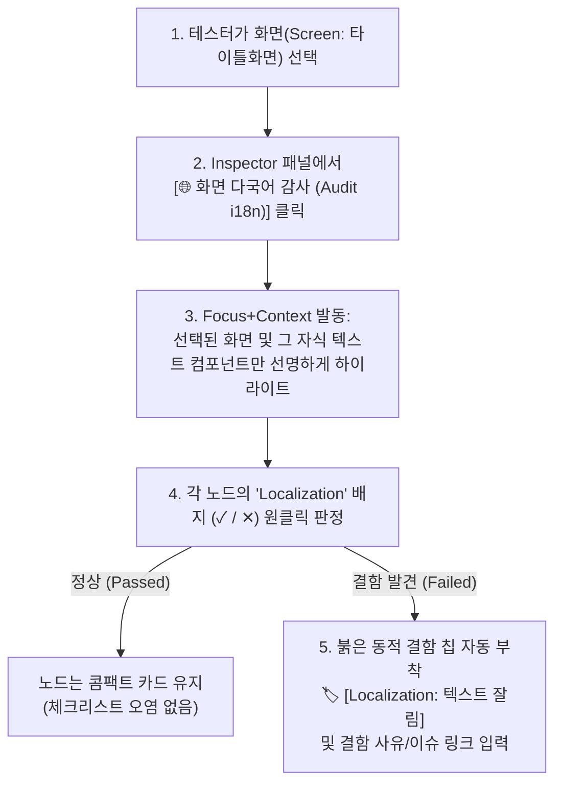

# Cross-Cutting Localization Audit & Global Badge Interaction Specification

**Document Version:** 1.0.0  
**Target Audience:** Senior AI Coding Models (Argon, Opus 5.5, Gemini 4) & QA Engineers  
**Related Documents:** [AI_IMPLEMENTATION_SPEC.md](file:///e:/Workspace/coveragemap/AI_IMPLEMENTATION_SPEC.md), [TESTCASE_MODELING_AND_STATE_PROPAGATION.md](file:///e:/Workspace/coveragemap/docs/TESTCASE_MODELING_AND_STATE_PROPAGATION.md)  
**Status:** Implemented (2026-10-14) — 글로벌 배지 Hover 소환 제거, 화면 단위 다국어 스코프 감사(`scope_root_id` & `[🌐 이 화면 다국어 검증 모드]`), 동적 결함 칩(`.fault-chip`) 구현 및 검증 완료

---

## 1. Executive Summary & Background (배경 및 제안 이유)

### 1.1. 사용자 문제 제기 및 배경 (Context)
게임 클라이언트 내 '텍스트 이미지', '알림 팝업', '버튼 레이블' 등 화면 곳곳에 존재하는 수많은 UI 노드는 **언어 설정 변경(시스템 언어 또는 인게임 클라이언트 언어) 시 해당 언어에 맞는 텍스트와 폰트로 정상 노출**되어야 합니다.

이를 CoverageMap에 적용하는 과정에서 2가지 실무적 한계 및 버그성 동작이 발견되었습니다:

1. **[실무 비효율 / 인지 부하] 텍스트가 있는 수십 개 노드마다 로컬라이제이션 체크리스트 개별 작성의 문제**:
   - 단순 기능 확인을 위한 노드마다 중복된 다국어 체크리스트 항목을 일일이 추가하면 노드 크기가 커지고 데이터가 비대해집니다.
   - 그러나 실무 QA 프로세스에서는 기능 검증을 먼저 마친 뒤, **'언어 설정을 변경한 사전 조건' 하에서 글로벌 관점으로 다국어 품질(미번역, 텍스트 잘림/말줄임, 폰트 깨짐)을 별도 회차로 일괄 점검**하는 것이 일반적입니다.
2. **[버그성 인터랙션] 배지(Badge) Hover 시 글로벌 노드가 화면 중앙에 강제 소환(Teleportation)되는 현상**:
   - 노드 카드 내 `DEPENDENCIES` 섹션의 `[Localization ✓ ✕ | ⊘]` 배지 위에 마우스 포인터를 올리면, `SCREEN Localization` 글로벌 노드가 뷰포트 정중앙에 불쑥 튀어나와 작업 시야를 가리는 현상이 발생합니다.

---

## 2. Root Cause Analysis (원인 분석)

### 2.1. 배지 Hover 소환 버그 원인 (`frontend/src/App.tsx`)
- `CoverageNode.tsx`의 배지 `onMouseEnter` 이벤트가 `hoverGlobalBadge` 커스텀 이벤트를 발생시키고, `App.tsx`에서 `hoveredGlobalBadgeId` 상태를 설정합니다.
- `App.tsx`의 `ReactFlow` `nodes` 렌더링 블록(`lines ~1784-1801`)에서 다음과 같이 동작합니다:
  ```tsx
  if (n.id === hoveredGlobalBadgeId) {
    return {
      ...n,
      hidden: false,
      position: center, // 뷰포트 정중앙 화면 좌표로 강제 이동!
      style: { ...n.style, zIndex: 'var(--z-active-node)', boxShadow: '0 0 20px rgba(0, 229, 255, 0.5)' },
      className: `${n.className || ''} hovered-global-neighbor`,
    };
  }
  ```
- **문제점**: 사용자는 단순히 배지 상태를 보려고 마우스를 올렸을 뿐인데, 숨겨져 있거나 멀리 있던 글로벌 노드가 화면 중앙으로 순간이동하여 다른 노드들을 덮어버리고 시야를 방해합니다.

### 2.2. 로컬라이제이션 모델링 괴리
- 모든 검증을 노드 내부 체크리스트로 해결하려 하면, 횡단 관심사(Cross-cutting Concern)의 특성상 수십 개 노드에 동일한 체크리스트가 중복 복제되어 관리가 불가능해집니다.
- 반대로 캔버스 전체에 글로벌 노드와의 엣지를 직접 그리면 엣지 스파게티(Edge Clutter)가 발생합니다.
- 따라서 **대규모 그래프에서도 사람의 인지 부하를 줄일 수 있는 '작업 영역(Workspace / Screen) 한정 스코프 감사 체계'**가 필요합니다.

---

## 3. Standard Design & Interaction Specification (표준 설계 및 인터랙션 규격)

### 3.1. 2번 버그 수정: 글로벌 노드 중앙 소환(Teleportation) 완전 제거
- **소환 로직 삭제**: 배지 Hover 시 `n.id === hoveredGlobalBadgeId`인 글로벌 노드를 `hidden: false`로 만들고 `position: center`로 강제 이동시키는 코드를 완전히 제거합니다.
- **경량 피드백 유지**:
  1. 배지 위에 마우스를 올리면 `CoverageNode.tsx` 내부에 이미 구현된 **가이드 툴팁(`badge-tooltip`)**만 노출됩니다.
  2. 현재 캔버스에 이미 표시 중인 연결 노드들에만 은은한 외곽선 하이라이트(`.hovered-global-neighbor`) 또는 부드러운 점선 엣지를 제공하되, 카메라 뷰포트나 노드 위치는 일체 건드리지 않습니다.

### 3.2. 1번 실무 모델링: 화면(Screen/Container) 단위 스코프 감사 (Scoped Perspective Audit)
전체 그래프를 한 번에 감사하면 수백 개의 노드가 쏟아져 인지 부하가 발생하므로, 테스터가 현재 검증 중인 화면 단위로 한정하여 점진적 감사를 진행합니다.



#### 세부 운영 원칙:
1. **노드 체크리스트 순수성 유지**: 일반 기능 노드의 `properties.checklist`에는 기능 고유의 동작(또는 특정 화면에만 존재하는 고유 번역 스펙)만 담고, 공통 다국어 검증 항목을 모든 노드에 중복 삽입하지 않습니다.
2. **글로벌 배지 `description`에 5대 문자 세트 위험군 가이드 내장**:
   - 글로벌 배지 노드의 `properties.checklist`에 항목을 추가하면 1개 화면의 결함이 모든 부착 노드에 전파(전역 상태 오염)되므로, 글로벌 배지의 **`description` (Verification Guide 툴팁)**에 아래 **5대 문자 세트 위험군**을 표준 점검 기준으로 명시합니다:
     | 위험군 | 대상 언어 예시 | 핵심 블랙박스 시각 검증 포인트 |
     | :--- | :--- | :--- |
     | **① 라틴/유럽어군 (팽창)** | EN, DE, FR, ES, RU | 원문 대비 30~50% 길이 팽창 시 버튼 영역 침범, 줄바꿈 밀림, 말줄임(`...`) 정상 동작 여부 |
     | **② 한·중·일 (CJC 글리프)** | KO, JA, ZH-CN/TW | 단어/음절 단위 줄바꿈 금칙 처리 및 번체/간체·일본 한자 폰트 폴백 누락으로 인한 두부현상(`□`, Tofu) 여부 |
     | **③ 성조·복모음 상하첨자** | TH (태국어), VI (베트남어) | 기본 자모 위아래로 쌓이는 성조/모음 기호가 줄 간격(Line Height)과 겹치거나 텍스트 박스 상하단에 잘리는(Vertical Clipping) 현상 |
     | **④ 양방향 (BiDi / RTL)** | AR (아랍어), HE (히브리어) | 우→좌(RTL) UI 레이아웃/정렬 미러링 여부 및 숫자·영문 변수(LTR) 혼용 시 문자열 순서 역전 현상 |
     | **⑤ 동적 변수 / 복수형 치환** | 전 언어 공통 (`{0}`, `%s`) | 유저 닉네임·재화 수량 등 가변 길이 인자 치환 시 미치환 문자열 노출 및 복수형 문법 분기 시 레이아웃 오버플로우 |
3. **글로벌 배지 원클릭 판정**: 배지 내부의 `✓`(Passed) / `✕`(Failed) 클릭으로 해당 노드의 다국어 검증 결과를 즉시 기록합니다.
4. **Detail-on-Demand 동적 칩**: 통과된 노드는 콤팩트한 카드를 유지하고, 실패한 노드에만 붉은 결함 칩(`🏷️ [Localization: 결함]`)을 카드에 부착하여 한눈에 결함 지점을 식별합니다.

---

## 4. Implementation Directives for Next AI Model (차기 모델 구현 지시서)

차기 AI 모델은 본 지침서에 따라 아래 파일들을 수정해야 합니다.

### 4.1. 프론트엔드 작업 (`frontend/src/App.tsx`, `CoverageNode.tsx`)
1. **`frontend/src/App.tsx` Hover 소환 제거**:
   - `lines ~1784-1801`의 `nodes` 매핑 함수에서 `if (n.id === hoveredGlobalBadgeId)` 블록(중앙 순간이동 및 unhide)을 삭제합니다.
   - 글로벌 노드가 캔버스에 별도 물리 노드로 배치되어 있지 않은 경우, 배지 hover로 인해 임의의 노드가 캔버스에 생성되거나 튀어나오지 않도록 차단합니다.
2. **화면(Screen) 단위 다국어 감사 트리거 연동 (`App.tsx` Inspector)**:
   - `selectedNode?.data.label === 'Screen'`이거나 `selectedNode?.data.hasChildren`인 노드를 선택했을 때, Inspector 패널에 **`[🌐 이 화면 다국어 검증 모드]`** 버튼을 추가합니다.
   - 클릭 시 해당 화면과 직속 자식 노드들 중 `Localization` 배지를 가진 노드들만 `Focus+Context`로 강조하고 나머지는 dim 처리합니다.

### 4.2. 백엔드 작업 (`backend/graph_service.py`, `backend/main.py`)
1. **`GET /api/qa/audit-cross-cutting` (MCP `audit_cross_cutting`) 스코프 파라미터 확장**:
   - `scope_root_id: Optional[str] = None` 파라미터를 추가합니다.
   - `scope_root_id`가 주어지면, 해당 노드 및 그 하위 `Contains` 자식 노드 범위 내에서만 다국어 누락/통과 여부를 집계하여 반환합니다.

### 4.3. 검증 기준 (Verification Criteria)
- [x] **Tier 1 검사**: `backend/.venv/Scripts/python.exe scripts/check_policy.py` 통과 (Exit Code 0).
- [x] **Hover 버그 검증**: 캔버스에서 노드의 `Localization` 배지 위에 마우스를 올려도 `SCREEN Localization` 카드가 화면 중앙에 튀어나오지 않는지 확인.
- [x] **스코프 감사 검증**: 부모 Screen 노드 선택 후 다국어 감사 실행 시, 해당 화면과 하위 텍스트 컴포넌트만 Focus 하이라이트되는지 확인.

