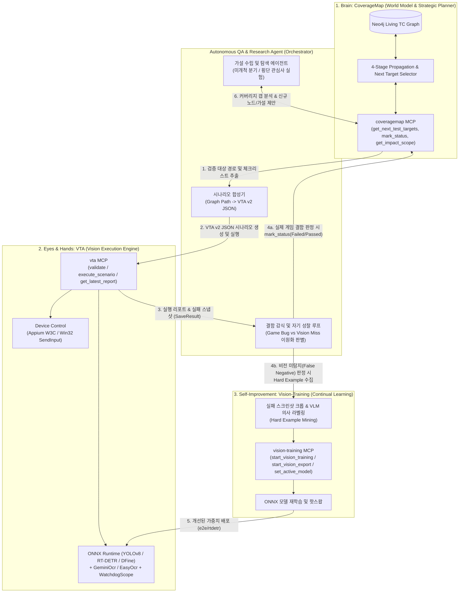
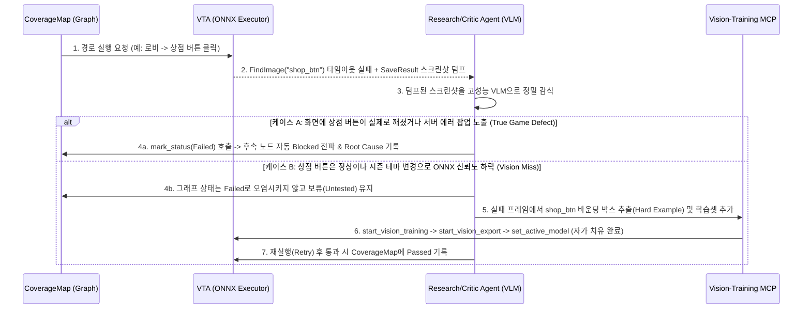

# Future Architecture Vision: Vision-Based Autonomous Testing & Research-Driven Self-Improving Framework
## 비전 기반 자율 테스트 및 연구 기반 자기 개선 프레임워크 장기 청사진

**문서 버전:** 1.0.0 (Long-Term Roadmap Draft)  
**작성 일자:** 2026-11-04  
**문서 상태:** ⏳ **Future Vision / Deferred (현재 단계 구현 보류 — 장기 로드맵 보존용)**  
**대상 독자:** 프로젝트 아키텍트, QA 리드 엔지니어, 차세대 AI 코딩 에이전트  
**관련 문서:**
- [AI_IMPLEMENTATION_SPEC.md](file:///e:/Workspace/coveragemap/AI_IMPLEMENTATION_SPEC.md)
- [FEATURE_PRUNING_GUIDE.md](file:///e:/Workspace/coveragemap/FEATURE_PRUNING_GUIDE.md)
- [TESTCASE_MODELING_AND_STATE_PROPAGATION.md](file:///e:/Workspace/coveragemap/docs/TESTCASE_MODELING_AND_STATE_PROPAGATION.md)
- [PROPOSAL_TAG_BASED_DOMAIN_GROUPING.md](file:///e:/Workspace/coveragemap/docs/PROPOSAL_TAG_BASED_DOMAIN_GROUPING.md)

---

> [!IMPORTANT]
> **AI 에이전트를 위한 스코프 가드 (Scope Guard for AI Agents — DO NOT IMPLEMENT YET)**
> - 본 문서는 **향후 멀티모달 비전/에이전트 모델의 추론 성능이 더욱 성숙하고, CoverageMap의 기초 사용성(Phase 0) 검증이 완전히 마무리된 이후**에 나아갈 장기 아키텍처 방향성을 기록한 문서입니다.
> - **현재 개발 단계(기초 사용성 검토 및 코어 안정화 단계)에서는 본 문서의 기능을 임의로 코드베이스에 구현하거나 백엔드/프론트엔드에 비전 관련 의존성을 추가해서는 안 됩니다.**
> - 사용자가 명시적으로 본 문서의 특정 Phase 착수를 지시할 때에만 구현을 시작하십시오.

---

## 1. Executive Summary & Strategic Rationale (배경 및 전략적 타당성)

### 1.1. 왜 'CoverageMap'이 자율 게임 테스팅의 핵심 퍼즐인가?
기존의 비전 기반 게임 자동화 및 자율 테스팅 연구(Reinforcement Learning, Random Monkey, 순수 VLM 화면 탐색)는 실무 QA에 도입될 때 다음과 같은 근본적인 한계에 부딪혔습니다:
1. **장기 상태 기억(World Model)의 부재**: 에이전트가 현재 화면만 보고 행동하므로, 전체 게임 구조 중 **어디까지 검증되었고(`Passed`), 어디가 미검증(`Untested`)인지** 기억하지 못해 이미 방문한 화면을 무한 배회합니다.
2. **선행 결함과 후속 차단의 구분 불가**: 로그인이나 상점 진입 API가 깨졌을 때(`Failed`), 후속 구매 테스트들이 연쇄 차단(`Blocked`)되어야 함에도 에이전트가 무의미한 재시도를 반복합니다.
3. **순환 루프(Cycle) 데드락**: 게임 내비게이션의 필수 요소인 뒤로가기/팝업 닫기(`Return`)와 정방향 진행(`Transition`)을 구분하지 못해 테스트 의존성 그래프가 순환에 빠집니다.

**CoverageMap**은 Neo4j 기반의 **위상적 월드 모델(Topological World Model)**이자 **4단계 상태 전파 엔진(`Untested` / `Passed` / `Failed` / `Blocked`)**으로서, 비전 실행 엔진(`VTA`)과 비전 학습 파이프라인(`Vision-Training`)에 **'전략적 두뇌(Brain)'**를 제공합니다.

### 1.2. 순수 블랙박스 QA 원칙과의 완벽한 정합성
[AI_IMPLEMENTATION_SPEC.md](file:///e:/Workspace/coveragemap/AI_IMPLEMENTATION_SPEC.md) 1.3절에 정의된 **블랙박스 QA 및 제로-코드 접근 정책(Zero-Code Black-Box Constraint)**에 따라, 퍼블리셔 및 전담 QA 환경에서는 게임 클라이언트 소스 코드나 엔진 내부 에셋(Unity Prefab, Unreal UMG)에 접근할 수 없습니다.  
비전 기반 자율 테스트는 오직 **화면에 렌더링된 픽셀(Vision/OCR)**과 **외부 입력 제어(Appium/Win32)**만으로 동작하므로, 블랙박스 QA 원칙을 100% 준수하면서 수동 테스트를 자율화할 수 있는 가장 정통적인 접근법입니다.

---

## 2. 3대 MCP 생태계 통합 폐루프 아키텍처 (The 3-Pillar Closed-Loop Architecture)

워크스페이스 생태계를 구성하는 3개의 독립 MCP 서버(`coveragemap`, `vta`, `vision-training`)는 각각 **두뇌(Brain)**, **눈과 손(Eyes & Hands)**, **시냅스 가소성/학습기(Continual Learner)** 역할을 수행하며 하나의 자기 개선 폐루프를 형성합니다.



### 2.1. Room-Door-Furniture 3계층 모델과 비전 노드의 1:1 매핑
[TESTCASE_MODELING_AND_STATE_PROPAGATION.md](file:///e:/Workspace/coveragemap/docs/TESTCASE_MODELING_AND_STATE_PROPAGATION.md) 3.5절의 **Room-Door-Furniture 3계층 분리 원칙**은 VTA의 실행 노드 규격과 구조적 변경 없이 그대로 매핑됩니다:

| CoverageMap 계층 | 도메인 의미 | VTA 비전/액션 노드 매핑 | 자율 검증 메커니즘 |
| :--- | :--- | :--- | :--- |
| **Room (`Screen`, `Popup`)** | 사용자가 입력을 멈추고 머무르는 독립 공간 | `SaveResult` (UI Health Monitor), `VerifyContainsNode` | 화면 진입 후 필수 앵커 UI 클래스(`target_classes`)가 모두 탐지되는지 검사하여 정상 진입 판정 (누락 시 스크린샷 자동 덤프) |
| **Door (`Transition`, `Return` 엣지)** | 다른 방으로 이동시키는 행위 통로 (`action` 트리거) | `FindImage` ➔ `Touch` / `Swipe` / `WinClick` + `WatchdogScope` | 엣지의 `action`에 대응하는 UI 클래스를 ONNX로 탐지해 좌표를 클릭하고, `WatchdogScope`로 화면 프리징/정체 감지 |
| **Furniture (`Component`, `checklist`)** | 방 안에 고정된 정적 스펙 및 시각 품질 | `FindImage`, `GeminiOcr`, `EasyOcr`, `Condition`, `VerifyContainsNode` | 체크리스트 각 항목을 OCR 텍스트 비교(`Condition`) 또는 부모-자식 포함 검증(`VerifyContainsNode`)으로 자동 판정 |

---

## 3. 연구 기반 자기 개선(Research-Driven Self-Improvement)의 3대 핵심 루프

단순한 매크로 실행기를 넘어 **스스로 연구하고 개선하는 자율 프레임워크**로 진화하기 위한 핵심 메커니즘입니다.

### 3.1. Loop 1: 결함 이원화 감식 및 비전 모델 자가 치유 (Perception Self-Healing)
비전 기반 자동화에서 테스트가 실패(`Fail`)했을 때 가장 중요한 과제는 **"실제 게임 결함(True Game Bug)인가, 아니면 비전 인식기의 미탐지(Vision False Negative)인가?"**를 분리하는 것입니다.



- **효과**: 게임 UI 리뉴얼이나 시즌 테마 변경 시 사람이 일일이 템플릿 이미지를 다시 따지 않아도, 에이전트가 실패 스냅샷에서 Hard Example을 추출해 로컬 ONNX 모델(`RT-DETR`/`DFine`/`YOLOv8`)을 재학습하고 가중치를 핫스왑합니다.

### 3.2. Loop 2: 시나리오 복원 및 그래프 위상 자가 적응 (Topology Self-Healing)
- **돌발 모달 탈출 및 등록**: 테스트 경로 이동 중 `'신규 시즌 출석 팝업'` 등 기존 그래프에 없던 휘발성 모달(`#Popup`)이 등장해 경로가 막히면, 에이전트가 닫기 버튼(`Return` 엣지)을 스스로 추론해 원래 경로로 복귀하고 CoverageMap에 신규 팝업 노드와 `Return` 엣지를 후보로 제안합니다.
- **신뢰도 가중 최단 경로(Shortest Reliable Path)**: 특정 미검증 노드(`Untested`)나 스펙 변경 영향권(`highlight-affected`) 노드에 진입할 수 있는 경로가 여러 개일 때, 과거 VTA 실행 성공률과 소요 시간을 가중치로 삼아 가장 빠르고 안정적인 진입 경로를 선택합니다.

### 3.3. Loop 3: 자율 연구 에이전트 기반 가설-실험 루프 (Hypothesis-Driven QA Research)
야간 무인 테스트(Overnight Run) 등에서 에이전트가 **연구 가설 수립(Hypothesis) ➔ 실험 시나리오 합성(Experiment) ➔ 실행 및 관찰(Observation) ➔ 지식 축적(Memory)**을 자율 반복합니다:
1. **커버리지 갭 및 횡단 관심사 가설 도출**:
   - `get_next_test_targets`, `get_impact_scope`, `audit_cross_cutting`을 조회하여 *"현재 `#Popup` 태그가 붙은 모달 중 다국어(독일어/아랍어) 텍스트 오버플로우가 미검증된 4개 팝업"* 또는 *"스펙 변경(`is_modified: true`) 이후 2-hop 영향권에 있는 하위 화면"*을 실험 타겟으로 선정합니다.
2. **변이 실험(Mutation Testing) 수행**:
   - 정방향 해피 패스뿐만 아니라, `Loop` 노드를 활용한 반복 진입/취소(`Return`), 대기 시간(`Wait`) 단축 등 엣지 케이스 변이 시나리오를 생성해 검증합니다.
3. **경험 메모리(Episodic QA Memory) 축적**:
   - 노드 및 엣지의 `properties`에 실행 이력, 비전 신뢰도 분포, 결함 재현율을 기록하여 차기 빌드 회귀 테스트의 우선순위를 스스로 고도화합니다.

---

## 4. 코어 아키텍처 보호를 위한 3대 가드레일 (Architectural Guardrails)

향후 본 프레임워크를 구현할 때에도 [AI_IMPLEMENTATION_SPEC.md](file:///e:/Workspace/coveragemap/AI_IMPLEMENTATION_SPEC.md)와 [FEATURE_PRUNING_GUIDE.md](file:///e:/Workspace/coveragemap/FEATURE_PRUNING_GUIDE.md)의 핵심 설계 원칙을 절대 훼손해서는 안 됩니다.

> [!WARNING]
> **가드레일 1: CoverageMap 코어의 경량성 유지 (MCP 기반 느슨한 결합)**
> - CoverageMap 백엔드(`backend/`)나 프론트엔드(`frontend/`)에 OpenCV, PyTorch, ONNX Runtime, Appium 등 무거운 비전/디바이스 제어 라이브러리를 직접 추가하는 것은 금지됩니다.
> - CoverageMap은 오직 **그래프 데이터 모델과 4단계 상태 전파 엔진**으로만 유지하고, 모든 비전 추론(`vta`)과 모델 재학습(`vision-training`)은 MCP 프로토콜을 통해 외부에서 느슨하게 결합(Loose Coupling)해야 합니다.

> [!CAUTION]
> **가드레일 2: 자율 탐색에 의한 그래프 폭발(Graph Clutter) 및 `Max Depth = 1` 위반 차단**
> - 에이전트가 화면에서 발견한 모든 버튼/아이콘/텍스트를 무분별하게 독립 `Component` 노드로 생성하면 캔버스 가독성이 붕괴됩니다.
> - 에이전트의 그래프 확장 규칙:
>   1. 캔버스 노드는 반드시 **독립된 화면(`Screen`) 또는 팝업(`Popup`)** 단위로만 생성을 제안합니다 (`Max Depth = 1` 엄수).
>   2. 화면 내부의 개별 UI 요소 및 정적 텍스트 검증은 **B안(`properties.checklist`)** 항목으로 평탄화하여 등록합니다.
>   3. 뒤로가기/닫기 동작은 반드시 `type: "Return"`(전파 가중치 `0`)으로 연결하여 순환 차단 데드락을 방지합니다.

> [!NOTE]
> **가드레일 3: Human-in-the-Loop 최종 승인 체계 (`is_modified` & `Acknowledge` 활용)**
> - 자율 에이전트가 새로 발견해 추가한 노드나 자동 갱신한 스펙은 즉시 확정하지 않고 `mark_node_modified`(`properties.is_modified = true`) 상태로 마킹합니다.
> - 인간 QA 엔지니어가 캔버스의 보라색 맥동 하이라이트(`.node-modified-pulse`)를 확인하고 Inspector에서 **`[✓ 변경사항 확인 완료 (Acknowledge)]`**를 클릭함으로써 최종 통제권을 유지합니다.

---

## 5. 단계별 진화 로드맵 (Phased Evolution Roadmap)

### Phase 0: 기초 사용성 검토 및 코어 안정화 (Current Stage 📍)
- **목표**: 인간 QA 엔지니어가 CoverageMap 캔버스와 MCP 대화를 통해 게임 화면 흐름과 체크리스트를 직관적으로 모델링·관리할 수 있도록 기초 UX 및 안정성을 완비합니다.
- **완료 조건**: 실무 프리셋 구축 및 수동/대화형 Living TC 운용에서 사용성 병목이 없을 것.

### Phase 1: 시맨틱-비전 브릿지 메타데이터 규격화 (Semantic-to-Vision Grounding)
- **목표**: 백엔드 스키마 변경 없이 기존 `properties` JSON 필드를 활용해 CoverageMap 엔티티와 VTA 비전 클래스를 매핑하는 표준 컨벤션을 도입합니다.
- **표준 `properties` 확장 규격 예시**:
  ```json
  {
    "id": "node_shop_popup",
    "label": "Popup",
    "name": "상점 구매 팝업 #Popup",
    "properties": {
      "vision_anchor_classes": ["popup_shop_frame", "btn_buy_confirm"],
      "vta_module_id": "mod_shop_purchase_v2",
      "execution_stats": {
        "total_runs": 14,
        "flaky_vision_misses": 1,
        "last_artifact_path": "reports/shop_fail_snapshot.png"
      },
      "checklist": [
        {
          "id": "chk_1",
          "text": "구매 버튼 텍스트 및 가격 숫자가 정상 노출된다.",
          "status": "Passed",
          "vision_rule": {
            "type": "GeminiOcr",
            "roi": "420,680,620,740",
            "expect_regex": "^[0-9,]+ G$"
          }
        }
      ]
    }
  }
  ```

### Phase 2: 에이전트 오케스트레이션 기반 자율 실행 (Closed-Loop Execution)
- **목표**: 전용 에이전트 스킬(`.agents/skills/autonomous-vision-qa/SKILL.md`)을 통해 `coveragemap`(`get_next_test_targets`) ➔ `vta`(`validate_scenario` ➔ `execute_scenario` ➔ `get_latest_report`) ➔ `coveragemap`(`mark_status`)으로 이어지는 자율 실행 및 상태 전파 루프를 구축합니다.

### Phase 3: 비전 모델 자가 치유 파이프라인 (Active Learning & Auto Retraining)
- **목표**: VTA 실패 스냅샷(`SaveResult`)에 대한 VLM 감식 ➔ Hard Example 자동 수집 ➔ `vision-training` MCP(`start_vision_training` ➔ `start_vision_export` ➔ `set_active_model`) 연동을 통해 UI 변화에 스스로 적응하는 비전 파이프라인을 완성합니다.

### Phase 4: 연구 기반 자율 탐색 및 가설 검증 에이전트 (Autonomous QA Researcher)
- **목표**: 미개척 화면 자율 탐색, 다국어/화면비 횡단 관심사(`audit_cross_cutting`) 야간 무인 실험, 위험도 기반 회귀 우선순위 자가 학습을 수행하는 완전 자율형 QA 리서치 프레임워크로 확장합니다.
