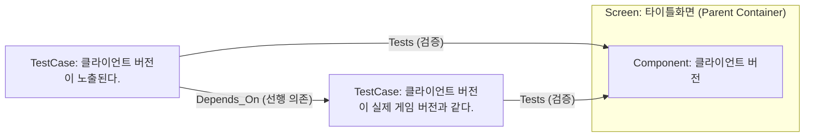
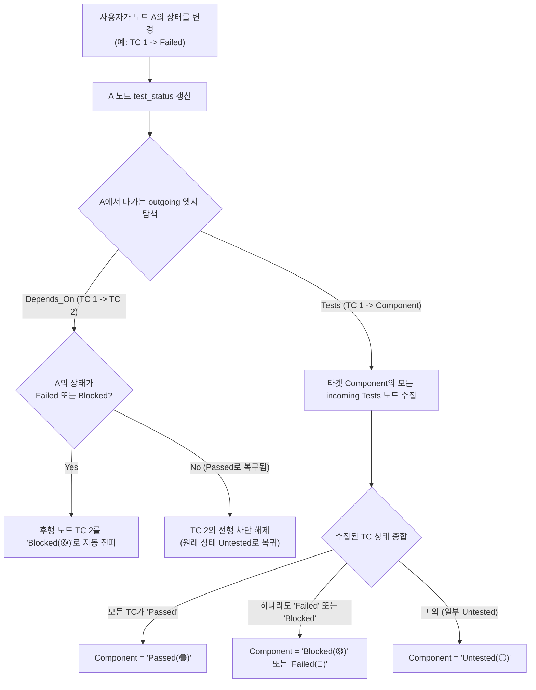
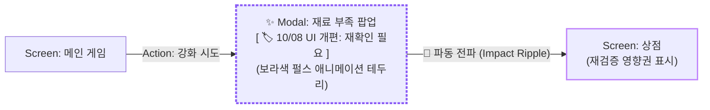

# TestCase Modeling & 4-Stage State Propagation Specification

**Document Version:** 1.0.0  
**Target Audience:** Senior AI Coding Agents & QA Engineers  
**Related Documents:** [AI_IMPLEMENTATION_SPEC.md](file:///e:/Workspace/coveragemap/AI_IMPLEMENTATION_SPEC.md), [UI_UX_DESIGN_SYSTEM.md](file:///e:/Workspace/coveragemap/UI_UX_DESIGN_SYSTEM.md)  
**Status:** Implemented (2026-10-11) — 구현 결과 및 원 명세와 달라진 결정 사항은 [8. 구현 결과 및 결정 기록](#8-구현-결과-및-결정-기록-implementation-record-2026-10-11) 참조

---

## 1. Executive Summary & Background (배경 및 제안 이유)

### 1.1. 사용자 문제 제기 및 배경 (Context)
모바일 게임 QA 실무에서 하나의 화면 내 UI 컴포넌트를 검증할 때, 테스터는 세부 검증 항목(체크리스트/테스트케이스)을 작성합니다.  
예를 들어, **'타이틀 화면'** 내의 **'클라이언트 버전'** 컴포넌트에 대해 다음과 같은 검증이 필요합니다:
1. `TC 1`: "클라이언트 버전 텍스트가 화면에 정상 노출된다."
2. `TC 2`: "클라이언트 버전이 실제 배포된 게임 릴리즈 버전과 일치한다."

이 두 항목 사이에는 명확한 **선행 - 후행 의존성**이 존재합니다:
> 텍스트 노출 자체가 실패(`Failed`)하면, 버전 숫자가 일치하는지 확인하는 후속 테스트는 수행할 수 없으므로 차단(`Blocked`)되어야 합니다.

사용자는 이를 다음과 같이 직관적으로 모델링하였습니다:
- `Screen: 타이틀화면` (부모 컨테이너) 안에 `Component: 클라이언트 버전` (자식 노드)을 배치.
- 캔버스 좌측에 2개의 `TestCase` 노드를 배치하고 `Component`로 연결.
- `TC 1`에서 `TC 2`로 선후 관계 화살표를 연결하고자 함.



---

## 2. Gap Analysis in Current System (현재 시스템의 3대 한계 및 원인 분석)

본 제안이 나온 근본적인 이유는 현재 코드베이스에 다음 3가지 구현상의 괴리가 존재하기 때문입니다:

### 2.1. 한계 1: 노드 상태 변경 시 타겟 노드로의 전파 단절 (No Node-to-Node Rollup)
- **현상**: 테스터가 `TC 1` 노드를 클릭하고 우측 패널에서 `Mark Passed`를 눌러도, 대상 컴포넌트(`클라이언트 버전`)는 여전히 `Untested` 상태로 남아있습니다.
- **원인**:
  - `frontend/src/App.tsx`의 `handleSaveStatus`는 노드를 수정할 때 대상 노드 본체의 `test_status`만 바꿀 뿐, 해당 노드에서 뻗어나가는 outgoing 엣지나 타겟 노드를 재계산하지 않습니다.
  - 반면 `recalculateTargetStatus` 및 `backend/graph_service.py`의 `_recalc_target_node_status`는 오직 **"들어오는 엣지 자체의 test_status (`in_r.test_status`)"**만 보고 타겟 노드의 상태를 결정합니다.
  - 이로 인해 테스터는 노드 상태 따로, 엣지 상태 따로, 컴포넌트 상태 따로 이중/삼중으로 수동 조작해야 하는 문제가 있습니다.

### 2.2. 한계 2: Edit Node UI에 `Blocked` 상태 누락 (Missing Blocked Action)
- **현상**: 기획서([AI_IMPLEMENTATION_SPEC.md](file:///e:/Workspace/coveragemap/AI_IMPLEMENTATION_SPEC.md) 3.1)에는 4단계 상태(`Untested`, `Passed`, `Failed`, `Blocked`)가 명시되어 있으나, `App.tsx`의 Edit Node 패널에는 `Mark Passed`, `Mark Failed`, `Reset Status` 3개 버튼만 존재합니다.
- **원인**:
  - `Blocked`는 원래 "선행 조건 실패 시 시스템이 자동으로 산출하는 파생 상태(Computed State)"로 기획되었기 때문에 수동 마킹 버튼에서 제외되었습니다.
  - 그러나 선행 노드(`TC 1`)가 `Failed`가 되었을 때 후행 노드(`TC 2`)로 `Blocked`를 전파하는 자동 트리거가 누락되어 있어 결과적으로 `Blocked` 상태가 도출되지 못했습니다.
  - 또한, 네트워크 점검, 빌드 미배포 등 외부 환경 요인으로 인해 테스터가 특정 노드를 **수동 차단(Manual Blocked)**해야 하는 실무 요구를 반영하지 못했습니다.

### 2.3. 한계 3: 캔버스 노드 방식 vs 노드 내부 체크리스트 방식의 가이드 부재
- 화면 1개당 컴포넌트가 10개 이상이고 각 컴포넌트마다 3~5개의 TC가 캔버스 노드로 배치되면, 화면 하나 주변에 30~50개의 작은 노드가 생성되어 **그래프 폭발(Graph Clutter)**이 발생합니다.
- 따라서 어떤 경우에 캔버스 독립 노드를 쓰고, 어떤 경우에 노드 속성 체크리스트로 관리할지에 대한 명확한 도메인 모델링 가이드가 필요합니다.

---

## 3. Domain Modeling Standard (표준 도메인 모델링 규격)

### 3.1. 관계 유형 표준 (Edge Taxonomy)
| 엣지 타입 (`type`) | 출발 노드 (`source`) | 도착 노드 (`target`) | 의미 및 영향도 |
| :--- | :--- | :--- | :--- |
| **`Contains`** | `Screen` (부모) | `Component` (자식) | 물리적 포함 관계 (Subflow Max Depth = 1 준수) |
| **`Depends_On`** | `TestCase` (선행) | `TestCase` (후행) | 선행 검증이 실패/차단되면 후행 검증도 `Blocked` 처리됨 |
| **`Tests`** | `TestCase` (검증) | `Component` / `Feature` | 하위 TC 검증 결과가 상위 컴포넌트로 롤업(Roll-up) 집계됨 |
| **`Transition`** | `Screen` / `Feature` | `Screen` / `Feature` | 화면 전환 및 기능 흐름 간 상호작용 |

### 3.2. A안(캔버스 독립 노드) vs B안(노드 내부 체크리스트) 비교 분석

| 비교 항목 | A안: 캔버스 독립 TestCase 노드 | B안: 노드 내부 체크리스트 (실무 권장 🌟) |
| :--- | :--- | :--- |
| **모델링 형태** | 각 검증 항목마다 캔버스에 사각형 노드 생성 | 컴포넌트 1개만 노출, 세부 항목은 노드 속성(`checklist`)에 내장 |
| **인간 인지 부하** | **매우 높음 (그래프 폭발 위험)**<br/>컴포넌트 10개 x 검증 3개 = 30~40개 노드로 시야 마비 | **매우 낮음 (깔끔한 캔버스 유지)**<br/>캔버스에는 핵심 컴포넌트만 보이고 세부 내용은 클릭 시 확인 |
| **적합한 유스케이스** | 화면 간 전환, 외부 시스템 연동 등 **시각적 선후 관계(`Depends_On`)가 거시적으로 중요한 핵심 흐름** | **단순 UI 확인(텍스트 노출, 깨짐, 폰트, 버전 일치 등) 일상적인 컴포넌트 단위 검증** |
| **상태 판정 방식** | 엣지 기반 자동 롤업 (`TC ➔ Component`) | 체크리스트 항목 종합 판정 (`checklist ➔ Node Status`) |

### 3.3. B안(노드 내부 체크리스트) 상세 설계 및 UX 명세

B안은 테스터의 정보 과부하를 방지하고 일상적인 QA 생산성을 극대화하기 위한 핵심 구현 규격입니다.

#### 1. 데이터 모델 (Data Schema)
노드의 `properties.checklist` 필드에 JSON 배열로 저장합니다:
```json
{
  "id": "node_client_version",
  "label": "Component",
  "name": "클라이언트 버전",
  "test_status": "Passed",
  "properties": {
    "checklist": [
      { "id": "chk_1", "text": "클라이언트 버전 텍스트가 정상 노출된다.", "status": "Passed" },
      { "id": "chk_2", "text": "텍스트가 깨지지 않고 폰트가 정상이다.", "status": "Passed" },
      { "id": "chk_3", "text": "실제 배포된 릴리즈 버전과 일치한다.", "status": "Passed" }
    ]
  }
}
```

#### 2. 체크리스트 기반 노드 상태 자동 산출 규칙
- 체크리스트가 없는 노드: 기존처럼 상단의 `Mark Passed / Failed` 수동 조작 유지.
- 체크리스트가 1개 이상 등록된 노드:
  - 항목 중 하나라도 `Failed(🔴)`가 있으면 ➔ 노드 `test_status = 'Failed'`
  - 항목 중 하나라도 `Blocked(🟡)`가 있고 `Failed`가 없으면 ➔ 노드 `test_status = 'Blocked'`
  - 모든 항목이 `Passed(🟢)`이면 ➔ 노드 `test_status = 'Passed'`
  - 그 외(일부 `Untested` 등) ➔ 노드 `test_status = 'Untested'`

#### 3. UI/UX 구현 명세
- **노드 카드 요약 표시 (`CoverageNode.tsx`)**:
  - `data.properties.checklist`가 존재하면, 카드 하단에 미니 프로그레스 뱃지 노출:
    - 예: `[ 🟢 3/3 (100%) ]` 또는 `[ 🔴 1 결함 / 3 항목 ]`
  - 캔버스를 멀리서 보아도 해당 컴포넌트의 체크리스트 진행 상황을 즉시 인지 가능.
- **우측 인스펙터 패널 (`App.tsx` Edit Node)**:
  - "세부 체크리스트 (Verification Checklist)" 섹션 추가.
  - 각 항목별 원클릭 상태 토글 (`⚪` / `🟢` / `🔴` / `🟡`) 및 텍스트 수정.
  - `[+ 새 검증 항목 추가]` 버튼 및 개별 항목 삭제(`🗑️`) 지원.
  - 항목 체크 시 즉시 낙관적 업데이트(Optimistic Update)로 노드 상태 및 프로그레스 뱃지 동기화.

### 3.4. 게임 순환 루프(Cycle)와 복귀선(`Return` 엣지) 규격
게임 내비게이션은 `로비 ⇄ 상점`, `던전 ⇄ 결과창`처럼 순환(Cycle)이 필수적입니다. 그러나 테스트 의존성 그래프가 순환하면 무한 차단(Deadlock)에 빠집니다.
- **해결 원칙 (엣지 역할 분리)**:
  - **진입선 (`type: "Transition"` / `"Depends_On"`)**: 상태 전파 **ON**. 선행 노드 결함 시 타겟 노드를 `Blocked` 처리.
  - **복귀선 (`type: "Return"`)**: 상태 전파 **OFF (가중치 = 0)**. 뒤로가기, 팝업 닫기 등 단순 내비게이션 복귀선으로 취급하여, 복귀 대상 화면으로 결함이 역류하지 않도록 차단.
- **알고리즘 반영**: 타겟 노드의 상태를 집계하는 `_recalc_target_node_status` 및 `recalculateTargetStatus`에서 `edge.type === 'Return'`인 엣지는 상태 계산 입력에서 완전히 제외합니다.

### 3.5. 3가지 확인 대상 분리 원칙 (Room-Door-Furniture 치트시트)
모든 검증 요소를 노드로 만들려다 Depth=1 규칙을 위반하고 그래프가 폭발하는 것을 방지하기 위해, 모든 확인 대상을 3가지 계층으로 엄격히 분리합니다:
1. **노드 (Node / Room)**: 사용자가 입력을 멈추고 머무르는 독립 공간 (화면 `Screen`, 팝업 `Modal`).
2. **엣지 (Edge / Door)**: 사용자를 다른 방으로 이동시키는 행위 통로 (버튼 터치, 바로가기 액션).
3. **체크리스트 (Checklist / Furniture)**: 그 방 안에 고정된 정적 스펙 및 시각 품질 (타이틀 텍스트, 본문 내용, 수량, 폰트 깨짐 없음).

### 3.6. 휘발성 모달(Transient Popup) 및 닫기 처리 모델링
"메인 게임 ➔ 재료 부족 팝업 ➔ 상점 바로가기 ➔ (상점에서 뒤로가기 시 팝업 없이 바로) 메인 게임 복귀"와 같은 모달 스택 소멸 구조:
- `[Screen: 메인 게임]` ──(제작 시도)──▶ `[Modal: 재료 부족 팝업]`
- `[Modal: 재료 부족 팝업]` ──(상점 바로가기 클릭)──▶ `[Screen: 상점]`
- `[Screen: 상점]` ──(상점 닫기 / type: Return)──▶ `[Screen: 메인 게임]` (전파 차단)
- `[Modal: 재료 부족 팝업]` ──(팝업 닫기 / type: Return)──▶ `[Screen: 메인 게임]` (전파 차단)

### 3.7. 파편화된 실무 환경에서의 N개 팝업 태그(`#Popup`) 전수 회귀 체계
실제 라이브 게임 개발에서는 팝업마다 프리팹과 코드가 달라 Dimmed 적용 여부, 뒷배경 터치 차단 여부가 제각각 파편화되어 있습니다.
- **개별 검증**: 각 팝업 노드 내부의 체크리스트에서 자기 팝업 고유의 `[Dimmed]`, `[Overlap]` 스펙을 독립 검증.
- **일괄 전수 회귀 (Regression Audit)**:
  1. 모든 팝업 노드에 `aliases: ["Popup"]` 또는 `label: "Modal"` 지정.
  2. 팝업 시스템 전체 패치 시 검색창에 `#Popup` 입력 ➔ 게임 내 N개의 모든 팝업이 원클릭 하이라이트(Focus+Context).
  3. 팝업 노드 상태를 일괄 `Untested`로 리셋하고 체크리스트를 순회하며 10분 만에 완벽한 전수 리그레션 달성.

---

## 4. 4-Stage State Propagation Engine Specification

### 4.1. 4단계 상태 정의
- **`Untested` (⚪ #64748b)**: 아직 테스트되지 않은 기본 상태.
- **`Passed` (🟢 #22c55e)**: 검증 성공.
- **`Failed` (🔴 #ef4444)**: 결함 발견 (실패).
- **`Blocked` (🟡 #f59e0b)**: 선행 의존성 결함 또는 외부 요인으로 인해 진행 불가.

### 4.2. 전파 및 자동 롤업 알고리즘 (Cascading Rollup Algorithm)



### 4.3. 수동 오버라이드 (📌 Manual Override) 정책
- 테스터가 외부 요인(빌드 미제공, 기기 없음)으로 인해 특정 노드를 강제로 `Blocked` 처리할 수 있어야 합니다.
- Edit Node 패널에서 `Mark Blocked`를 누르면 `is_manual_override: true`로 마킹되고 사유(`override_reason`)를 필수로 입력받습니다.
- 오버라이드된 노드는 선행 노드의 자동 계산에 의해 덮어쓰기 되지 않고 유지됩니다.

---

## 5. Implementation Directives for Senior Model (차기 모델 구현 지시서)

차기 AI 모델은 아래 명시된 파일과 함수를 수정하여 본 규격을 완성해야 합니다:

### 5.1. 프론트엔드 작업 (`frontend/src/App.tsx`)
1. **`Edit Node` 패널 UI 확장 (`lines ~1950-1956`)**:
   - `Mark Passed`, `Mark Failed` 옆에 **`Mark Blocked`** 버튼 추가.
   - `Blocked` 클릭 시 오버라이드 사유(`override_reason`) 입력 팝업/인풋 제공.
2. **`handleSaveStatus` 노드 전파 로직 추가 (`lines ~840-915`)**:
   - 노드 상태가 저장될 때, 해당 노드를 `source`로 하는 모든 outgoing 엣지를 탐색.
   - `e.type === 'Depends_On'`인 경우:
     - `newStatus === 'Failed' || newStatus === 'Blocked'`이면 타겟 노드를 `Blocked`로 자동 갱신.
     - `newStatus === 'Passed'`이면 타겟 노드의 차단을 해제하여 `Untested`로 복귀.
   - `e.type === 'Tests'`인 경우:
     - 타겟 컴포넌트의 모든 incoming TC 노드들의 상태를 조회하여 롤업 계산 후 컴포넌트 상태 갱신.
3. **`recalculateTargetStatus` 함수 개선 (`lines ~829-839`)**:
   - 들어오는 엣지(`e.data.test_status`)뿐만 아니라, **출발지 노드(`sourceNode.data.test_status`)**의 상태도 함께 고려하여 계산하도록 개선.
   - **`e.type === 'Return'`인 엣지는 집계 대상에서 제외**하여, 뒤로가기/복귀 화살표로 인한 상태 전파 무한 루프(Deadlock) 차단.
4. **B안: 노드 내부 체크리스트 에디터 및 뱃지 연동**:
   - `frontend/src/App.tsx`: Edit Node 폼에 `Checklist` 섹션을 추가하고, 항목 추가/삭제 및 개별 항목 상태(`Untested`/`Passed`/`Failed`/`Blocked`) 변경 시 노드 `properties.checklist` 및 종합 `test_status`를 자동 산출하여 낙관적 업데이트.
   - `frontend/src/CoverageNode.tsx`: `data.properties.checklist`가 존재할 경우 카드 본체에 `[ 🟢 3/3 (100%) ]` 프로그레스 뱃지를 표시하도록 렌더링 추가.

### 5.2. 백엔드 작업 (`backend/graph_service.py`)
1. **`update_node` 함수 내 연쇄 전파 호출 추가 (`lines ~235-282`)**:
   - 노드의 `test_status`가 변경되면, `_recalc_target_node_status(session, record["next_id"])`를 호출하여 outgoing 노드들의 상태를 실시간 연쇄 재계산 (단, `type = 'Return'`인 엣지는 전파 대상에서 제외).
2. **`_recalc_target_node_status` Cypher 쿼리 개선 (`lines ~295-328`)**:
   - 엣지 상태만 보는 대신, 출발 노드의 상태도 함께 수집하되 `Return` 엣지는 상태 전파에서 제외:
     ```cypher
     MATCH (target) WHERE elementId(target) = $target_id
     OPTIONAL MATCH (src)-[in_r]->(target)
     WHERE in_r.type IS NULL OR in_r.type <> 'Return'
     WITH target, collect({
         edge_status: coalesce(in_r.test_status, 'Untested'),
         src_status: coalesce(src.test_status, 'Untested'),
         edge_type: coalesce(in_r.type, 'Transition')
     }) AS inputs
     ...
     ```
   - `Depends_On` 관계에서 `src_status`가 `Failed` 또는 `Blocked`이면 타겟은 `Blocked` 처리.
   - `Tests` 관계에서 모든 `src_status`가 `Passed`이면 타겟은 `Passed` 처리.

---

## 6. Verification Guidelines (검증 기준)
1. **Tier 1 (정적 검사)**: `python scripts/check_policy.py` 통과 (0 Exit Code).
2. **E2E 테스트 시나리오**:
   - [x] `TC 1`을 `Failed`로 마킹 시, `Depends_On`으로 연결된 `TC 2`가 즉시 `Blocked(🟡)`로 자동 변경되는가? *(pytest `test_status_propagation.py`, E2E `verify_state_engine_2026_10.spec.ts` A)*
   - [x] `TC 1`을 다시 `Passed`로 복구 시, `TC 2`의 차단이 해제되는가? *(동일)*
   - [x] `TC 1`과 `TC 2`가 모두 `Passed`일 때, 대상 `Component`가 자동으로 `Passed(🟢)`로 변경되는가? *(pytest `test_status_propagation.py`)*
   - [x] Edit Node에서 `Mark Blocked`를 눌렀을 때 📌 핀 아이콘 및 사유가 정상 저장되는가? *(E2E B)*

---

## 7. 차기 기능 명세: 변경 영향도 강조 및 수정 전파 기능 (Change Impact Ripple Highlight)

> **대상 에이전트:** 차기 상위 모델 (Argon, Claude Opus 5.5, GPT-5)  
> **기능 목적:** 개발팀의 기획/코드 수정 발생 시, 테스터가 재검증(Regression) 스코프를 즉각 인지할 수 있도록 수정된 노드 및 후속 영향 경로를 시각적으로 강조하는 Living Document 특화 기능.



### 7.1. 데이터 모델 (Data Schema)
노드 `properties`에 변경 이력 및 영향도 추적 필드를 추가:
```json
{
  "properties": {
    "is_modified": true,
    "modified_note": "상점 바로가기 버튼 UI 개편 (Jira: GAME-1234)",
    "modified_at": "2026-10-08T18:40:00Z"
  }
}
```

### 7.2. UI/UX 표현 및 애니메이션 (Pure CSS Rule 1 준수)
- **수정 노드 본체 (`CoverageNode.tsx`)**:
  - `properties.is_modified === true`인 노드에 `.node-modified-pulse` CSS 클래스 부여.
  - CSS 스타일: 바이올렛 테두리(#8b5cf6)와 부드러운 네온 글로우 펄스 애니메이션 (2s infinite ease-in-out).
  - 카드 상단에 동적 칩 `✨ [Spec Updated]` 노출.
- **다운스트림 영향권 파동 (Impact Ripple)**:
  - 수정된 노드로부터 뻗어나가는 outgoing 엣지 및 1~2차 후속 노드에 `.highlight-affected` 스타일을 적용하여 재검증 영향권임을 시각화.

### 7.3. 테스터 검증 라이프사이클 (Acknowledge Lifecycle)
1. **인지**: 테스터가 캔버스를 열었을 때 보라색 펄스가 깜빡이는 노드를 통해 당일 수정 사항을 1초 만에 식별.
2. **확인**: 노드 클릭 시 우측 인스펙터 패널에 `⚠️ 변경 내역: 상점 바로가기 버튼 UI 개편` 안내 배너 노출.
3. **확인 완료 (Acknowledge)**:
   - 테스터가 게임에서 확인 및 체크리스트 검증을 마친 후 **`[✓ 변경사항 확인 완료 (Acknowledge)]`** 버튼 클릭.
   - 백엔드 `is_modified = false` 갱신 및 낙관적 업데이트로 펄스 효과 소멸, 정상 상태(Passed🟢)로 복귀.

### 7.4. 차기 모델(Argon / Opus 5.5)을 위한 백엔드/프론트엔드 작업 지시
1. **백엔드 (`backend/main.py` 및 `graph_service.py`)**:
   - `POST /api/nodes/{id}/mark-modified`: 노드를 수정 상태로 지정 (`is_modified=true`, `modified_note` 기록).
   - `POST /api/nodes/{id}/acknowledge`: 테스터의 확인 완료 처리 (`is_modified=false`).
2. **프론트엔드 (`frontend/src/App.tsx`, `CoverageNode.tsx`, `index.css`)**:
   - `index.css`: `.node-modified-pulse` 및 `@keyframes pulse-modified` 애니메이션 추가.
   - `CoverageNode.tsx`: `is_modified` 플래그 감지 시 칩 노출 및 클래스 적용.
   - `App.tsx`: 우측 인스펙터에 Acknowledge 버튼 및 `modified_note` 렌더링.

---

## 8. 구현 결과 및 결정 기록 (Implementation Record, 2026-10-11)

> 위 1~7장의 원 명세는 기록 보존을 위해 그대로 두고, 실제 구현과 원 명세가 달라진 지점만 여기에 기록합니다.

### 8.1. 구현 위치
| 영역 | 파일 / 심볼 |
| :--- | :--- |
| 상태 합성 (순수 함수) | `backend/graph_service.py` → `compute_synthesized_status` |
| 연쇄 전파 (워크리스트) | `backend/graph_service.py` → `_run_propagation`, `_propagate_to_dependents`, `_recalc_single_node_status`, `_recalc_target_node_status` |
| 변경 표시 / 확인 | `backend/graph_service.py` → `mark_node_modified`, `acknowledge_node_modification` / `backend/main.py` → `POST /api/nodes/{id}/mark-modified`, `POST /api/nodes/{id}/acknowledge` |
| 상태 재동기화 | `GET /api/node-statuses` → `{elementId: test_status}` (`get_node_statuses`) |
| 프론트 미러 엔진 | `frontend/src/statusPropagation.ts` (`computeSynthesizedStatus`, `runPropagation`, `propagateToDependents`, `recalcTargetAndPropagate`, `applyStatusChanges`) |
| Inspector UI | `frontend/src/App.tsx` → Mark Blocked + 사유 입력, 체크리스트 에디터(`saveChecklist`), 변경 영향도 섹션(`handleMarkModified`, `handleAcknowledge`, `affectedScope`) |
| 노드 카드 | `frontend/src/CoverageNode.tsx` → 📌 핀, 체크리스트 진행률 배지, `✨ [Spec Updated]` 칩, `.node-modified-pulse` |
| 테스트 | `backend/test_status_propagation.py`, `backend/test_edit_api.py`, `e2e-tests/tests/verify_state_engine_2026_10.spec.ts` |

### 8.2. 원 명세 대비 결정 사항
1. **5.2의 Cypher 정정**: Neo4j에서 관계 타입은 속성이 아니므로 `in_r.type`이 아니라 `type(in_r)`로 읽고, 대소문자 혼용(`Depends_On`/`DEPENDS_ON`)을 막기 위해 `toUpper`로 정규화합니다.
2. **전파 대상 관계 한정**: 연쇄 전파(소스 **노드** 상태를 입력으로 사용)는 `Depends_On`·`Tests` 두 관계에만 적용합니다. `Transition`/`Contains` 등 Flow 엣지는 기존처럼 **엣지 자체의 상태**로 판정(3.4의 진입선 규칙 유지)하고, `Return`은 입력에서 완전히 제외합니다.
3. **`Tests` 실패 우선**: 4.2 다이어그램의 "`Blocked` 또는 `Failed`" 모호성을 해소하여, `Tests` 소스 중 하나라도 `Failed`이면 대상은 `Failed`, (`Failed`가 없고) `Blocked`가 있으면 `Blocked`로 정했습니다.
4. **`Depends_On`만 있는 노드의 복구**: 선행이 정상으로 돌아오면 자동으로 부여됐던 `Blocked`만 `Untested`로 해제하고, 테스터가 직접 마킹한 `Passed`/`Failed`는 유지합니다.
5. **워크리스트 전파 + 사이클 안전성**: 재귀 대신 큐 기반으로 하류를 순회하며 이미 처리한 노드는 다시 넣지 않아, `Return`이 아닌 순환이 남아 있어도 무한 루프가 생기지 않습니다. 📌 고정 노드와 전역(Badge) 노드는 전파를 멈춥니다.
6. **체크리스트 저장 형식**: Neo4j 속성은 중첩 객체를 저장할 수 없으므로 `properties.checklist`를 JSON 문자열로 직렬화해 저장하고, API 경계에서 배열로 역직렬화합니다.
7. **Acknowledge는 상태를 바꾸지 않음 (7.3 정정)**: 7.3의 "정상 상태(Passed🟢)로 복귀"는 테스트 결과를 자동 조작하는 위험이 있어 채택하지 않았습니다. Acknowledge는 `is_modified=false`로 시각 효과만 해제하며, 재검증 결과는 테스터가 직접 마킹합니다. 같은 이유로 변경 표시 시 상태를 `Untested`로 자동 리셋하지도 않습니다.
8. **영향권 범위**: `.highlight-affected`는 변경 노드에서 나가는 방향으로 `Return`을 제외하고 **최대 2 hop**까지(7.2의 "1~2차 후속 노드") 적용합니다.
9. **프론트-서버 정합성**: 프론트엔드 `edges` 상태에는 `Contains`/배지 엣지가 빠져 있어 로컬 계산이 서버와 다를 수 있습니다. 따라서 로컬 계산은 낙관적 표시용으로만 쓰고, 저장 직후 `GET /api/node-statuses`로 서버 결과를 받아 덮어씁니다. (`/api/graph` 재조회를 하지 않으므로 레이아웃·줌이 유지됨)

### 8.3. 남은 과제
- **Root Cause Tracing 버튼 (AI_IMPLEMENTATION_SPEC 3.3)**: `.highlight-root-cause` CSS와 백엔드 역추적(`get_node_status_summary`)은 있으나, Inspector의 **[Trace Root Cause]** 버튼은 아직 연결되지 않았습니다.
