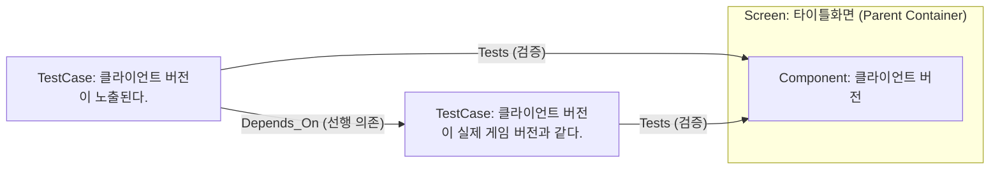
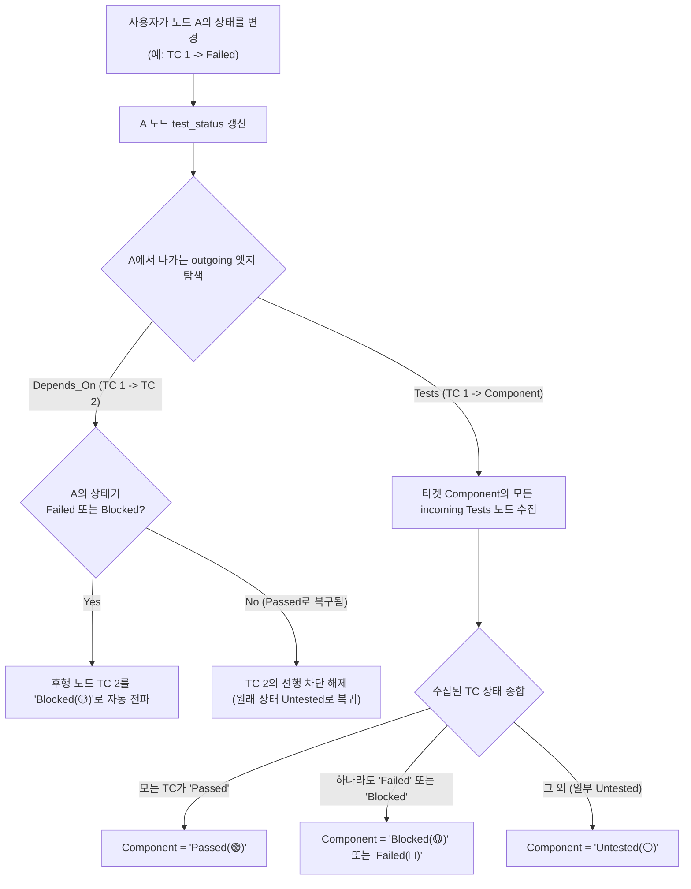
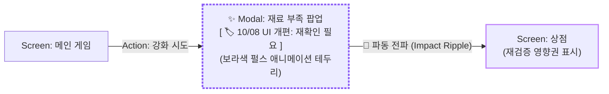

# TestCase Modeling & 4-Stage State Propagation Specification

**Document Version:** 2.0.0  
**Target Audience:** Senior AI Coding Agents & QA Engineers  
**Related Documents:** [AI_IMPLEMENTATION_SPEC.md](file:///e:/Workspace/coveragemap/AI_IMPLEMENTATION_SPEC.md), [UI_UX_DESIGN_SYSTEM.md](file:///e:/Workspace/coveragemap/UI_UX_DESIGN_SYSTEM.md)

---

## 1. Executive Summary & Background (배경 및 제안 이유)

### 1.1. 사용자 문제 제기 및 배경 (Context)
모바일 게임 QA 실무에서 하나의 화면 내 UI 컴포넌트를 검증할 때, 테스터는 세부 검증 항목(체크리스트/테스트케이스)을 작성합니다.  
예를 들어, **'타이틀 화면'** 내의 **'클라이언트 버전'** 컴포넌트에 대해 다음과 같은 검증이 필요합니다:
1. `TC 1`: "클라이언트 버전 텍스트가 화면에 정상 노출된다."
2. `TC 2`: "클라이언트 버전이 실제 배포된 게임 릴리즈 버전과 일치한다."

이 두 항목 사이에는 명확한 **선행 - 후행 의존성**이 존재합니다:
> 텍스트 노출 자체가 실패(`Failed`)하면, 버전 숫자가 일치하는지 확인하는 후속 테스트는 수행할 수 없으므로 차단(`Blocked`)되어야 합니다.

사용자는 이를 다음과 같이 직관적으로 모델링합니다:
- `Screen: 타이틀화면` (부모 컨테이너) 안에 `Component: 클라이언트 버전` (자식 노드)을 배치.
- 캔버스 좌측에 2개의 `TestCase` 노드를 배치하고 `Component`로 연결하거나, 노드 내부 체크리스트(B안)로 관리.
- `TC 1`에서 `TC 2`로 선후 관계 화살표를 연결.



---

## 2. 핵심 설계 원칙 (Core Design Rationale)

1. **노드 상태 변경 시 타겟 노드로의 자동 롤업 (Node-to-Node Rollup)**:
   - 테스터가 노드 상태 따로, 엣지 상태 따로 수동 조작하지 않도록, `Depends_On` 및 `Tests` 관계에서는 출발 노드의 상태 변경이 도착 노드로 자동 연쇄 전파되어야 합니다.
2. **자동 차단(`Blocked`)과 수동 차단(`📌 Mark Blocked`)의 공존**:
   - 선행 조건 실패 시 후속 노드가 자동으로 `Blocked(🟡)`로 전환되는 동시에, 네트워크 점검·빌드 미배포 등 외부 요인으로 인한 테스터의 수동 차단 고정(`is_manual_override: true` + `override_reason`)을 함께 지원해야 합니다.
3. **캔버스 독립 노드(A안)와 노드 내부 체크리스트(B안)의 역할 분담**:
   - 화면 1개당 컴포넌트가 10개 이상일 때 모든 세부 검증을 캔버스 노드로 만들면 그래프 폭발(Graph Clutter)이 발생하므로, 거시적 선후 의존 흐름(A안)과 일상적 UI/기능 스펙 점검(B안)의 모델링 기준을 명확히 분리합니다.

---

## 3. Domain Modeling Standard (표준 도메인 모델링 규격)

### 3.1. 관계 유형 표준 (Edge Taxonomy)
| 엣지 타입 (`type`) | 출발 노드 (`source`) | 도착 노드 (`target`) | 의미 및 영향도 |
| :--- | :--- | :--- | :--- |
| **`Contains`** | `Screen` (부모) | `Component` (자식) | 물리적 포함 관계 (Subflow Max Depth = 1 준수) |
| **`Depends_On`** | `TestCase` (선행) | `TestCase` (후행) | 선행 검증이 실패/차단되면 후행 검증도 `Blocked` 처리됨 |
| **`Tests`** | `TestCase` (검증) | `Component` / `Feature` | 하위 TC 검증 결과가 상위 컴포넌트로 롤업(Roll-up) 집계됨 |
| **`Transition`** | `Screen` / `Feature` | `Screen` / `Feature` | 화면 전환 및 기능 흐름 간 상호작용 |

### 3.2. A안(캔버스 독립 노드) vs B안(노드 내부 체크리스트) 비교 분석

| 비교 항목 | A안: 캔버스 독립 TestCase 노드 | B안: 노드 내부 체크리스트 (실무 권장 🌟) |
| :--- | :--- | :--- |
| **모델링 형태** | 각 검증 항목마다 캔버스에 사각형 노드 생성 | 컴포넌트 1개만 노출, 세부 항목은 노드 속성(`checklist`)에 내장 |
| **인간 인지 부하** | **매우 높음 (그래프 폭발 위험)**<br/>컴포넌트 10개 x 검증 3개 = 30~40개 노드로 시야 마비 | **매우 낮음 (깔끔한 캔버스 유지)**<br/>캔버스에는 핵심 컴포넌트만 보이고 세부 내용은 클릭 시 확인 |
| **적합한 유스케이스** | 화면 간 전환, 외부 시스템 연동 등 **시각적 선후 관계(`Depends_On`)가 거시적으로 중요한 핵심 흐름** | **단순 UI 확인(텍스트 노출, 깨짐, 폰트, 버전 일치 등) 일상적인 컴포넌트 단위 검증** |
| **상태 판정 방식** | 엣지 기반 자동 롤업 (`TC ➔ Component`) | 체크리스트 항목 종합 판정 (`checklist ➔ Node Status`) |

### 3.3. B안(노드 내부 체크리스트) 상세 설계 및 UX 명세

B안은 테스터의 정보 과부하를 방지하고 일상적인 QA 생산성을 극대화하기 위한 핵심 구현 규격입니다.

#### 1. 데이터 모델 (Data Schema)
노드의 `properties.checklist` 필드에 JSON 배열로 저장합니다:
```json
{
  "id": "node_client_version",
  "label": "Component",
  "name": "클라이언트 버전",
  "test_status": "Passed",
  "properties": {
    "checklist": [
      { "id": "chk_1", "text": "클라이언트 버전 텍스트가 정상 노출된다.", "status": "Passed" },
      { "id": "chk_2", "text": "텍스트가 깨지지 않고 폰트가 정상이다.", "status": "Passed" },
      { "id": "chk_3", "text": "실제 배포된 릴리즈 버전과 일치한다.", "status": "Passed" }
    ]
  }
}
```

#### 2. 체크리스트 기반 노드 상태 자동 산출 규칙
- 체크리스트가 없는 노드: 기존처럼 상단의 `Mark Passed / Failed` 수동 조작 유지.
- 체크리스트가 1개 이상 등록된 노드:
  - 항목 중 하나라도 `Failed(🔴)`가 있으면 ➔ 노드 `test_status = 'Failed'`
  - 항목 중 하나라도 `Blocked(🟡)`가 있고 `Failed`가 없으면 ➔ 노드 `test_status = 'Blocked'`
  - 모든 항목이 `Passed(🟢)`이면 ➔ 노드 `test_status = 'Passed'`
  - 그 외(일부 `Untested` 등) ➔ 노드 `test_status = 'Untested'`

#### 3. UI/UX 구현 명세
- **노드 카드 요약 표시 (`CoverageNode.tsx`)**:
  - `data.properties.checklist`가 존재하면, 카드 하단에 미니 프로그레스 뱃지 노출:
    - 예: `[ 🟢 3/3 (100%) ]` 또는 `[ 🔴 1 결함 / 3 항목 ]`
  - 캔버스를 멀리서 보아도 해당 컴포넌트의 체크리스트 진행 상황을 즉시 인지 가능.
- **우측 인스펙터 패널 (`App.tsx` Edit Node)**:
  - "세부 체크리스트 (Verification Checklist)" 섹션 추가.
  - 각 항목별 원클릭 상태 토글 (`⚪` / `🟢` / `🔴` / `🟡`) 및 텍스트 수정.
  - `[+ 새 검증 항목 추가]` 버튼 및 개별 항목 삭제(`🗑️`) 지원.
  - 항목 체크 시 즉시 낙관적 업데이트(Optimistic Update)로 노드 상태 및 프로그레스 뱃지 동기화.

### 3.4. 게임 순환 루프(Cycle)와 복귀선(`Return` 엣지) 규격
게임 내비게이션은 `로비 ⇄ 상점`, `던전 ⇄ 결과창`처럼 순환(Cycle)이 필수적입니다. 그러나 테스트 의존성 그래프가 순환하면 무한 차단(Deadlock)에 빠집니다.
- **해결 원칙 (엣지 역할 분리)**:
  - **진입선 (`type: "Transition"` / `"Depends_On"`)**: 상태 전파 **ON**. 선행 노드 결함 시 타겟 노드를 `Blocked` 처리.
  - **복귀선 (`type: "Return"`)**: 상태 전파 **OFF (가중치 = 0)**. 뒤로가기, 팝업 닫기 등 단순 내비게이션 복귀선으로 취급하여, 복귀 대상 화면으로 결함이 역류하지 않도록 차단.
- **알고리즘 반영**: 타겟 노드의 상태를 집계하는 `_recalc_target_node_status` 및 `recalculateTargetStatus`에서 `edge.type === 'Return'`인 엣지는 상태 계산 입력에서 완전히 제외합니다.

### 3.5. 3가지 확인 대상 분리 원칙 (Room-Door-Furniture 치트시트)
모든 검증 요소를 노드로 만들려다 Depth=1 규칙을 위반하고 그래프가 폭발하는 것을 방지하기 위해, 모든 확인 대상을 3가지 계층으로 엄격히 분리합니다:
1. **노드 (Node / Room)**: 사용자가 입력을 멈추고 머무르는 독립 공간 (화면 `Screen`, 팝업 `Modal`).
2. **엣지 (Edge / Door)**: 사용자를 다른 방으로 이동시키는 행위 통로 (버튼 터치, 바로가기 액션).
3. **체크리스트 (Checklist / Furniture)**: 그 방 안에 고정된 정적 스펙 및 시각 품질 (타이틀 텍스트, 본문 내용, 수량, 폰트 깨짐 없음).

### 3.6. 휘발성 모달(Transient Popup) 및 닫기 처리 모델링
"메인 게임 ➔ 재료 부족 팝업 ➔ 상점 바로가기 ➔ (상점에서 뒤로가기 시 팝업 없이 바로) 메인 게임 복귀"와 같은 모달 스택 소멸 구조:
- `[Screen: 메인 게임]` ──(제작 시도)──▶ `[Modal: 재료 부족 팝업]`
- `[Modal: 재료 부족 팝업]` ──(상점 바로가기 클릭)──▶ `[Screen: 상점]`
- `[Screen: 상점]` ──(상점 닫기 / type: Return)──▶ `[Screen: 메인 게임]` (전파 차단)
- `[Modal: 재료 부족 팝업]` ──(팝업 닫기 / type: Return)──▶ `[Screen: 메인 게임]` (전파 차단)

### 3.7. 파편화된 실무 환경에서의 N개 팝업 태그(`#Popup`) 전수 회귀 체계
실제 라이브 게임 개발에서는 팝업마다 프리팹과 코드가 달라 Dimmed 적용 여부, 뒷배경 터치 차단 여부가 제각각 파편화되어 있습니다.
- **개별 검증**: 각 팝업 노드 내부의 체크리스트에서 자기 팝업 고유의 `[Dimmed]`, `[Overlap]` 스펙을 독립 검증.
- **일괄 전수 회귀 (Regression Audit)**:
  1. 모든 팝업 노드에 `aliases: ["Popup"]` 또는 `label: "Modal"` 지정.
  2. 팝업 시스템 전체 패치 시 검색창에 `#Popup` 입력 ➔ 게임 내 N개의 모든 팝업이 원클릭 하이라이트(Focus+Context).
  3. 팝업 노드 상태를 일괄 `Untested`로 리셋하고 체크리스트를 순회하며 10분 만에 완벽한 전수 리그레션 달성.

---

## 4. 4-Stage State Propagation Engine Specification

### 4.1. 4단계 상태 정의
- **`Untested` (⚪ #64748b)**: 아직 테스트되지 않은 기본 상태.
- **`Passed` (🟢 #22c55e)**: 검증 성공.
- **`Failed` (🔴 #ef4444)**: 결함 발견 (실패).
- **`Blocked` (🟡 #f59e0b)**: 선행 의존성 결함 또는 외부 요인으로 인해 진행 불가.

### 4.2. 전파 및 자동 롤업 알고리즘 (Cascading Rollup Algorithm)



### 4.3. 수동 오버라이드 (📌 Manual Override) 정책
- 테스터가 외부 요인(빌드 미제공, 기기 없음)으로 인해 특정 노드를 강제로 `Blocked` 처리할 수 있어야 합니다.
- Edit Node 패널에서 `Mark Blocked`를 누르면 `is_manual_override: true`로 마킹되고 사유(`override_reason`)를 필수로 입력받습니다.
- 오버라이드된 노드는 선행 노드의 자동 계산에 의해 덮어쓰기 되지 않고 유지됩니다.

### 4.4. 상태 합성 및 전파 세부 결정 원칙
1. **관계 타입 정규화**: Neo4j에서 관계 타입은 속성이 아닌 `type(in_r)`로 조회하며, 대소문자 혼용(`Depends_On`/`DEPENDS_ON`) 방지를 위해 `toUpper`로 정규화합니다.
2. **전파 대상 관계 한정**: 연쇄 전파(출발 **노드** 상태를 입력으로 사용)는 `Depends_On`·`Tests` 두 관계에만 적용합니다. `Transition`/`Contains` 등 Flow 엣지는 **엣지 자체의 상태**로 판정하고, `Return`은 입력에서 완전히 제외합니다(가중치 `0`).
3. **`Tests` 실패 우선**: `Tests` 소스 중 하나라도 `Failed`이면 대상은 `Failed`로 전파되며, (`Failed`가 없고) `Blocked`가 있으면 `Blocked`로 산출됩니다.
4. **`Depends_On`만 있는 노드의 복구**: 선행이 정상으로 돌아오면 자동으로 부여됐던 `Blocked`만 `Untested`로 해제하고, 테스터가 직접 마킹한 `Passed`/`Failed`는 유지합니다.
5. **워크리스트 전파 및 사이클 안전성**: 큐(Worklist) 기반으로 하류를 순회하며 이미 처리한 노드는 재방문하지 않아 무한 루프를 방지합니다. 📌 고정 노드와 전역(`is_global`) 노드는 전파를 멈춥니다.
6. **체크리스트 직렬화 및 프론트-서버 동기화**: `properties.checklist`는 Neo4j에 JSON 문자열로 저장하고 API 경계에서 배열로 역직렬화합니다. 프론트엔드는 낙관적 업데이트 직후 `GET /api/node-statuses`로 서버 상태 맵을 받아 동기화하여 레이아웃 점프와 줌 초기화를 방지합니다.

---

## 5. 커버 가능 테스트 범위 및 한계 (Testable Scope & Boundaries)

### 5.1. CoverageMap이 강점을 가지는 6대 테스트 영역
| 분류 | 설명 및 모델링 방식 |
| :--- | :--- |
| **① 비선형 UI 씬 전환 및 모달 복귀 흐름** | 화면/모달 간 정방향 이동은 `Transition` 엣지(`action` 트리거 명시)로, 닫기/취소/뒤로가기 복귀는 `Return` 엣지(전파 가중치 `0`, 순환 데드락 방지)로 모델링 |
| **② 선후행 게이트 조건 및 연쇄 차단 (`Depends_On`)** | 선행 조건/API/시스템 노드가 `Failed` 또는 `Blocked`가 되면 후속 화면/기능 노드가 자동으로 `Blocked(🟡)`로 연쇄 전환되어 불필요한 테스트 낭비 방지 |
| **③ 단일 화면·팝업 내부 기능 동작 및 정적 UI 점검** | 화면을 벗어나지 않는 연속 기능 동작(예: 서드파티 호출 → 인증 완료 → 팝업 자동 닫힘)이나 레이아웃/텍스트/Dimmed 처리 여부는 **B안(노드 내부 `properties.checklist`)** 또는 **A안(`TestCase` 노드 + `Tests` 엣지)**으로 검증 (체크리스트 100% 통과 시 부모 노드 자동 `Passed`, 1개라도 실패 시 자동 `Failed`) |
| **④ 글로벌 횡단 관심사 (Cross-Cutting Concerns)** | 로컬라이제이션, 사운드, 네트워크 단절, 결제/권한 등 여러 화면에 걸치는 테스트는 `is_global: true` 전역 배지로 생성해 각 노드에 부착하고, 실패 시에만 붉은 결함 칩(`🔴`)으로 노출 (`audit_cross_cutting`으로 전수/화면 범위 감사) |
| **⑤ 파편화된 공통 UI 패턴의 일괄 회귀 점검** | `#Popup` 등 별칭(Tag)을 노드 이름에 부여하고 좌측 사이드바 검색 및 Focus+Context 필터링으로 모든 팝업의 공통 스펙(Dimmed 터치 시 닫힘 여부 등)을 일괄 점검 |
| **⑥ 스펙 변경 영향도 (`Change Impact Ripple`) 및 원인 역추적** | 기획 변경 시 `[⚡ 스펙 변경 표시]`로 최대 2-hop 후속 노드를 보라색(`.highlight-affected`)으로 하이라이트하고, 차단된 노드에서 `[🔍 결함 원인 역추적]`으로 최초 `Failed` 원흉 노드를 즉시 식별 |

### 5.2. 이 모델에서 다루기 어렵거나 적합하지 않은 영역 (한계)
1. **화이트박스 / 소스코드·엔진 에셋 의존 테스트 (정책적 금지)**: Unity/Unreal 프리팹·씬 파싱, 내부 클래스/변수 리플렉션 등은 블랙박스 QA 원칙(`AI_IMPLEMENTATION_SPEC.md` 1.3절)에 따라 엄격히 배제됩니다.
2. **다차원 조합 폭발 (Combinatorial Testing) 및 수치 밸런스/확률 검증**: `캐릭터(50) × 무기(100) × 스킬(20)` 데미지 공식 검증이나 가챠 10,000회 확률 분포 검증은 그래프 노드로 표현 시 캔버스가 폭발하므로, CoverageMap에서는 `'가챠 실행 및 결과 연출 확인'` 기능 수준만 노드로 두고 세부 확률표는 외부 시트로 검증합니다.
3. **연속적 조작감·물리 판정·시계열 성능 프로파일링**: 프레임 단위 타격 판정(히트박스), 지형 끼임, 30분 발열/메모리 누수/FPS 방어율 등 연속적 수치 데이터는 `Passed/Failed` 이산 상태 그래프로 표현하기 어렵습니다.
4. **실시간 타이밍 경합 (Race Condition / 광클·동시 입력)**: 프레임 단위 동시 터치나 백그라운드 강제 전환 연타 등 비결정적 타이밍 이슈는 정적 상태 전이 간선으로 모델링하기 어렵습니다 (단, *'결제 중 네트워크 단절'*처럼 시나리오가 고정된 항목은 전역 배지나 체크리스트로 등록 가능).
5. **2단계 이상 깊은 UI 컴포넌트 중첩**: `Max Depth = 1` 제약에 따라 `상점 → 탭 → 리스트 → 슬롯 → 툴팁` 식의 깊은 계층 중첩은 금지되며, 1단계 컨테이너 + 내부 체크리스트로 평탄화해야 합니다.

---

## 6. 실무 합의 모델링 패턴 (Standard QA Modeling Patterns)

### 6.1. 패턴 1: 연속된 팝업 내 기능 시퀀스는 '단일 팝업 노드 + 내부 체크리스트(B안)'로 압축
- **예시 시나리오**: `타이틀 화면 - 로그인 팝업 - 서드 파티 로그인 - 인증 성공 - 팝업 창 자동 닫힘 - 로그인 처리 완료`
- **권장 모델링**:
  - **캔버스 노드 (3개)**: `[타이틀 화면]` ──(`Transition: 로그인 버튼 터치`)──▶ `[로그인 팝업 #Popup]` ──(`Transition: 인증 성공 및 자동 닫힘`)──▶ `[인게임 로비 (로그인 완료)]` (및 팝업 취소 시 `[로그인 팝업]` ──(`Return: 닫기/취소`)──▶ `[타이틀 화면]`)
  - **`[로그인 팝업 #Popup]` 내부 체크리스트 (B안)**:
    - `[ ] 서드파티(Google/Apple/Guest) 로그인 버튼 터치 시 외부 인증창 정상 호출`
    - `[ ] 외부 인증 성공 시 팝업 창이 별도 조작 없이 자동으로 닫힘`
    - `[ ] 인증 취소 또는 실패 시 에러 토스트 노출 및 팝업 유지`
    - `[ ] 팝업 오픈 시 배경 Dimmed 처리 및 외부 영역 터치 동작 확인`
- **이유**: 화면/모달 단위로만 노드를 유지해 캔버스 복잡도를 낮추고, 세부 동작 단계는 체크리스트 진행률 배지(`☑ 3/4`)와 자동 상태 합성으로 관리합니다.

### 6.2. 패턴 2: 여러 화면에서 호출되는 공용 팝업은 '단일 노드 통합 + 진입 사전 조건 체크리스트'로 관리
- **상황**: `로그인 팝업`이 `타이틀 화면`뿐만 아니라 `설정 화면(계정 연동)` 등 여러 진입점에서 호출되는 경우.
- **권장 모델링**:
  - 노드를 화면별로 복제(`타이틀용 로그인 팝업`, `설정용 로그인 팝업`)하지 않고 **하나의 `[로그인 팝업 #Popup]` 노드로 통합**합니다.
  - 진입 경로별 확인 사항은 `로그인 팝업` 내부 체크리스트에 **진입 사전 조건 항목**(예: `[ ] [사전조건: 타이틀 진입] 비로그인 상태에서 호출 및 인증 후 로비 이동`, `[ ] [사전조건: 설정 진입] 게스트 상태에서 계정 연동 호출 및 연동 후 설정 화면 유지`)으로 구분하여 작성합니다.

### 6.3. 패턴 3: 다국어(Localization) 검증은 '글로벌 배지(5대 문자 세트 위험군 가이드) + 특정 화면 고유 스펙 체크리스트' 2계층으로 분리
- **상황**: 번역 텍스트의 문자 체계(한글/독일어/아랍어/태국어 등)에 따라 텍스트 박스 오버플로우, 줄바꿈, 성조 잘림, RTL 정렬 깨짐 등이 다르게 발생합니다.
- **권장 모델링**:
  1. **공통 시각/조판 품질 (`Global_Badge_I18N` 전역 배지 + `[🌐 이 화면 다국어 검증 모드]`)**:
     - 모든 노드에 동일한 다국어 체크리스트를 복제하지 않고, `Global_Badge_I18N` 전역 배지의 `description`(가이드 툴팁)에 아래 **5대 문자 세트 위험군**을 표준 점검 기준으로 명시합니다:
       | 위험군 | 대상 언어 예시 | 핵심 블랙박스 시각 검증 포인트 |
       | :--- | :--- | :--- |
       | **① 라틴/유럽어군 (팽창)** | EN, DE, FR, ES, RU | 원문 대비 30~50% 길이 팽창 시 버튼 영역 침범, 줄바꿈 밀림, 말줄임(`...`) 정상 동작 여부 |
       | **② 한·중·일 (CJC 글리프)** | KO, JA, ZH-CN/TW | 단어/음절 단위 줄바꿈 금칙 처리 및 번체/간체·일본 한자 폰트 폴백 누락으로 인한 두부현상(`□`, Tofu) 여부 |
       | **③ 성조·복모음 상하첨자** | TH (태국어), VI (베트남어) | 기본 자모 위아래로 쌓이는 성조/모음 기호가 줄 간격(Line Height)과 겹치거나 텍스트 박스 상하단에 잘리는(Vertical Clipping) 현상 |
       | **④ 양방향 (BiDi / RTL)** | AR (아랍어), HE (히브리어) | 우→좌(RTL) UI 레이아웃/정렬 미러링 여부 및 숫자·영문 변수(LTR) 혼용 시 문자열 순서 역전 현상 |
       | **⑤ 동적 변수 / 복수형 치환** | 전 언어 공통 (`{0}`, `%s`) | 유저 닉네임·재화 수량 등 가변 길이 인자 치환 시 미치환 문자열 노출 및 복수형 문법 분기 시 레이아웃 오버플로우 |
     - 테스터는 화면 단위 `[🌐 이 화면 다국어 검증 모드]`(`scope_root_id`)를 켜고 배지의 `✓`/`✕` 원클릭 판정으로 점검하며, 결함 발견 시에만 붉은 동적 결함 칩(`🏷️ [Localization: 결함]`)을 노출합니다.
  2. **특정 화면 고유 번역 스펙 (해당 노드의 B안 `properties.checklist`)**:
     - 특정 팝업/화면에만 존재하는 고유 다국어 스펙(예: 가챠 확률 팝업의 `{0}%` 동적 변수 치환 및 테이블 열 너비 줄바꿈)만 해당 노드의 내부 체크리스트에 1줄로 추가합니다.

---

## 7. 변경 영향도 강조 및 수정 전파 기능 (Change Impact Ripple Highlight)

개발팀의 기획/코드 수정 발생 시, 테스터가 재검증(Regression) 스코프를 즉각 인지할 수 있도록 수정된 노드 및 후속 영향 경로를 시각적으로 강조합니다.



### 7.1. 데이터 모델 (Data Schema)
노드 `properties`에 변경 이력 및 영향도 추적 필드를 저장합니다:
```json
{
  "properties": {
    "is_modified": true,
    "modified_note": "상점 바로가기 버튼 UI 개편 (Jira: GAME-1234)",
    "modified_at": "2026-10-08T18:40:00Z"
  }
}
```

### 7.2. UI/UX 표현 및 애니메이션 (Pure CSS Rule 1 준수)
- **수정 노드 본체 (`CoverageNode.tsx`)**:
  - `properties.is_modified === true`인 노드에 `.node-modified-pulse` CSS 클래스 부여 (바이올렛 테두리 `#8b5cf6` 및 2s 네온 글로우 펄스 애니메이션) 및 동적 칩 `✨ [Spec Updated]` 노출.
- **다운스트림 영향권 파동 (Impact Ripple)**:
  - 수정된 노드로부터 나가는 방향(`Return` 제외)으로 **최대 2 hop**까지의 후속 노드 및 엣지에 `.highlight-affected` 스타일을 적용하여 재검증 영향권임을 시각화합니다.
  - 영향받는 자식 컴포넌트를 포함한 부모 `Screen`이 접혀 있을 때(`isCollapsed: true`)는 부모 카드에도 `.highlight-affected`와 `.parent-collapse-impact-summary`(`⚡ 영향 하위 컴포넌트 N개`) 배지를 상향 롤업합니다.

### 7.3. 테스터 검증 라이프사이클 (Acknowledge Lifecycle)
1. **인지**: 테스터가 캔버스를 열었을 때 보라색 펄스가 깜빡이는 노드를 통해 당일 수정 사항을 즉시 식별.
2. **확인**: 노드 클릭 시 우측 인스펙터 패널에 변경 내역(`modified_note`) 안내 노출.
3. **확인 완료 (Acknowledge)**:
   - 테스터가 게임에서 확인 및 체크리스트 검증을 마친 후 **`[✓ 변경사항 확인 완료 (Acknowledge)]`** (`POST /api/nodes/{id}/acknowledge`) 클릭.
   - `is_modified = false`로 갱신되어 시각적 펄스 효과만 해제하며, 노드의 `test_status`는 자동으로 바꾸지 않고 테스터가 직접 판정 결과를 마킹합니다.

---

## 8. 실사용 시 예상되는 불편함 및 피드백 기반 재검토 백로그 (Known UX Friction & Backlog)

> 현재는 코드 수정 없이 현행 동작을 유지하며, 실제 모바일 게임 QA에 적용해 본 뒤 아래 항목에서 실무 불편 피드백이 발생할 경우 사용자 의사결정에 따라 우선적으로 기능 개선을 검토합니다.

### 8.1. 부분 결함 시 타 수단 우회 테스트 후 후속 노드 `Passed` 고정(`📌`) 미지원 (OR 게이트 우회 문제)
- **현재 동작 및 예상 불편**:
  - `로그인 팝업` 내부 체크리스트 중 *Apple 로그인*이 `Failed`이고 *Google/게스트 로그인*이 `Passed`인 경우, 체크리스트 합성에 의해 `로그인 팝업` 노드는 `Failed(🔴)`가 되며, 이에 의존하는 후속 노드(`인게임 로비`)는 자동으로 `Blocked(🟡)`가 됩니다.
  - 테스터가 정상 동작하는 Google/게스트 로그인으로 우회 진입하여 `인게임 로비`를 테스트한 뒤 웹 UI에서 `Mark Passed(🟢)`로 변경할 수 있으나, 현재 UI에서 `Mark Passed` 클릭 시 `is_manual_override: false`로 저장됩니다 (`Mark Blocked`만 `is_manual_override: true` 부여).
  - 그 결과, 이후 선행 노드(`로그인 팝업`)의 다른 체크리스트를 수정해 상태 전파가 다시 실행되면, 이미 우회 테스트를 마친 `인게임 로비`가 다시 `Blocked(🟡)`로 덮어써질 수 있습니다.
- **향후 재검토 방안**:
  - 실사용 중 우회 테스트 결과가 덮어써지는 불편이 확인될 경우, 웹 UI에서 **[우회 검증 완료 (`Passed` 📌 수동 고정)]** 옵션을 제공하거나, 의존성 엣지에 **OR 게이트(대체 경로 허용)** 속성을 부여하는 방안을 검토합니다.

### 8.2. 다중 진입(`Transition` N개) 통합 노드의 자동 `Passed` 합성 조건
- **현재 동작 및 예상 불편**:
  - `타이틀 화면`과 `설정 화면` 양쪽에서 하나의 통합 `로그인 팝업`으로 각각 `Transition` 엣지를 연결하면, 상태 합성 엔진(`compute_synthesized_status`)은 유입되는 **모든 `Transition` 엣지 자체의 상태가 `Passed`**여야만 노드의 자동 `Passed` 합성을 허용합니다.
  - 따라서 노드 내부 체크리스트를 100% `Passed`로 채워도, 연결된 진입 `Transition` 엣지들을 일일이 클릭해 `Passed`로 바꿔주지 않으면 통합 노드가 `Untested(⚪)`에 머물 수 있습니다.
- **향후 재검토 방안**:
  - 엣지 단위 상태 마킹이 번거롭다는 피드백이 있을 경우, `Transition` 엣지는 기본 통과(또는 노드 내부 체크리스트 우선)로 간주하는 합성 규칙 단순화를 검토합니다.

### 8.3. 부모-자식(`Contains`) 컨테이너 내부 자식 노드의 자동 `Passed` 합성 제약
- **현재 동작 및 예상 불편**:
  - 캔버스에서 `.edge-contains` 점선 엣지를 직접 선택하고 상태를 마킹할 수 있으나, 상태 합성(`compute_synthesized_status`)에서는 `Return`만 가중치 `0`으로 제외하고 `Contains`/`Has`는 일반 진입 엣지로 포함합니다.
  - 따라서 자식 노드의 체크리스트를 100% 통과시켜도 `Contains` 엣지 자체를 `Passed`로 바꾸지 않으면 자식 노드가 자동 `Passed`로 승격되지 않고 `Untested`로 남을 수 있습니다 (`Failed`는 정상 반영됨).
- **향후 재검토 방안**:
  - 부모-자식 그룹핑(`Contains`/`Has`)을 순수 구조적 포함 관계(가중치 `0`)로만 취급하길 원하는 피드백이 확인되면, `compute_synthesized_status` 및 프론트엔드 `statusPropagation.ts`에서 `Return`뿐만 아니라 `Contains`/`Has` 관계도 상태 합성 입력에서 제외하도록 개선합니다.

### 8.4. MCP 대화형 생성 시 내부 체크리스트(`properties.checklist`) 및 엣지 `action` 직접 입력 미지원
- **현재 동작 및 예상 불편**:
  - 현재 MCP 서버(`mcp_server/server.py`)의 `create_node`는 `label`, `name`, `aliases`만 받고 `properties`(체크리스트 등) 인자를 받지 않으며, `create_edge`도 `action` 속성을 받지 않습니다.
  - 따라서 AI 에이전트(MCP)와의 대화만으로 그래프 골격을 만든 뒤, 세부 체크리스트나 엣지 트리거(`action`)는 웹 UI의 Inspector 패널이나 JSON 프리셋에서 추가 입력해야 합니다 (단, 조회는 `get_node_details` 및 확장된 `find_node`로 가능).
- **향후 재검토 방안**:
  - MCP 대화를 통한 테스트 케이스 일괄 생성 빈도가 높아지면, `create_node` / `update_node` 및 `create_edge` MCP 도구 스키마에 `checklist` 배열과 `action` 문자열 파라미터를 확장합니다.

### 8.5. 전역 배지(`is_global`)의 엣지 방향성 및 영향도 리포트(`get_impact_scope`) 라벨 필터
- **현재 동작 및 예상 불편**:
  - 웹 UI에서 전역 배지를 부착하면 `대상노드 → 전역배지` 방향으로 `Depends_On`이 생성되어 배지가 실패해도 대상 노드가 `Blocked`되지 않고 붉은 결함 칩(`🔴`)만 표시되지만, 외부 JSON 프리셋에서 역방향(`전역배지 → 대상노드`)으로 작성할 경우 배지 실패 시 대상 노드가 `Blocked`로 전환될 수 있습니다.
  - 또한 `get_impact_scope` API의 텍스트 요약(`recommended_regression_scope`)은 현재 `Screen`, `Feature`, `TestCase` 라벨만 필터링하여 반환하므로 `Component`, `Modal`, `Data` 등 다른 라벨 노드는 요약 텍스트에서 누락될 수 있습니다 (단, 캔버스 `.highlight-affected` 시각 하이라이트 및 접힌 부모 롤업에는 정상 표시됨).
- **향후 재검토 방안**:
  - 프리셋 작성 및 영향도 텍스트 리포트 활용 과정에서 혼선이 발생할 경우, 전역 배지 엣지 방향 정규화 및 `recommended_regression_scope` 대상 라벨 확장을 검토합니다.

