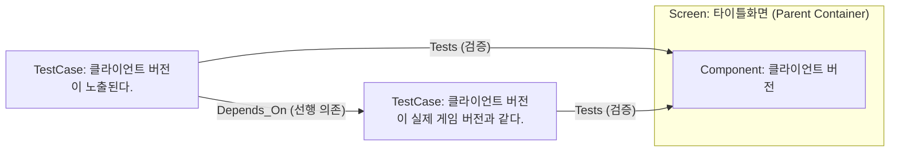
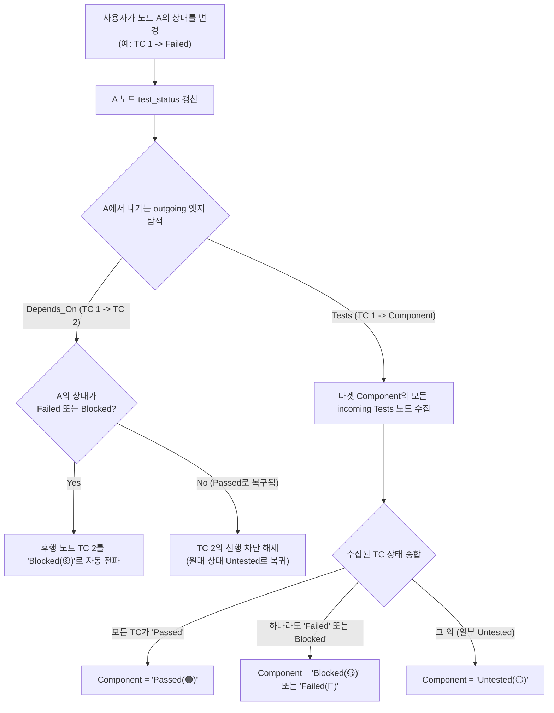

# TestCase Modeling & 4-Stage State Propagation Specification

**Document Version:** 1.0.0  
**Target Audience:** Senior AI Coding Agents & QA Engineers  
**Related Documents:** [AI_IMPLEMENTATION_SPEC.md](file:///d:/workspace/Coveragemap/AI_IMPLEMENTATION_SPEC.md), [UI_UX_DESIGN_SYSTEM.md](file:///d:/workspace/Coveragemap/UI_UX_DESIGN_SYSTEM.md)  
**Status:** Approved Specification (Ready for Implementation)

---

## 1. Executive Summary & Background (배경 및 제안 이유)

### 1.1. 사용자 문제 제기 및 배경 (Context)
모바일 게임 QA 실무에서 하나의 화면 내 UI 컴포넌트를 검증할 때, 테스터는 세부 검증 항목(체크리스트/테스트케이스)을 작성합니다.  
예를 들어, **'타이틀 화면'** 내의 **'클라이언트 버전'** 컴포넌트에 대해 다음과 같은 검증이 필요합니다:
1. `TC 1`: "클라이언트 버전 텍스트가 화면에 정상 노출된다."
2. `TC 2`: "클라이언트 버전이 실제 배포된 게임 릴리즈 버전과 일치한다."

이 두 항목 사이에는 명확한 **선행 - 후행 의존성**이 존재합니다:
> 텍스트 노출 자체가 실패(`Failed`)하면, 버전 숫자가 일치하는지 확인하는 후속 테스트는 수행할 수 없으므로 차단(`Blocked`)되어야 합니다.

사용자는 이를 다음과 같이 직관적으로 모델링하였습니다:
- `Screen: 타이틀화면` (부모 컨테이너) 안에 `Component: 클라이언트 버전` (자식 노드)을 배치.
- 캔버스 좌측에 2개의 `TestCase` 노드를 배치하고 `Component`로 연결.
- `TC 1`에서 `TC 2`로 선후 관계 화살표를 연결하고자 함.



---

## 2. Gap Analysis in Current System (현재 시스템의 3대 한계 및 원인 분석)

본 제안이 나온 근본적인 이유는 현재 코드베이스에 다음 3가지 구현상의 괴리가 존재하기 때문입니다:

### 2.1. 한계 1: 노드 상태 변경 시 타겟 노드로의 전파 단절 (No Node-to-Node Rollup)
- **현상**: 테스터가 `TC 1` 노드를 클릭하고 우측 패널에서 `Mark Passed`를 눌러도, 대상 컴포넌트(`클라이언트 버전`)는 여전히 `Untested` 상태로 남아있습니다.
- **원인**:
  - `frontend/src/App.tsx`의 `handleSaveStatus`는 노드를 수정할 때 대상 노드 본체의 `test_status`만 바꿀 뿐, 해당 노드에서 뻗어나가는 outgoing 엣지나 타겟 노드를 재계산하지 않습니다.
  - 반면 `recalculateTargetStatus` 및 `backend/graph_service.py`의 `_recalc_target_node_status`는 오직 **"들어오는 엣지 자체의 test_status (`in_r.test_status`)"**만 보고 타겟 노드의 상태를 결정합니다.
  - 이로 인해 테스터는 노드 상태 따로, 엣지 상태 따로, 컴포넌트 상태 따로 이중/삼중으로 수동 조작해야 하는 문제가 있습니다.

### 2.2. 한계 2: Edit Node UI에 `Blocked` 상태 누락 (Missing Blocked Action)
- **현상**: 기획서([AI_IMPLEMENTATION_SPEC.md](file:///d:/workspace/Coveragemap/AI_IMPLEMENTATION_SPEC.md) 3.1)에는 4단계 상태(`Untested`, `Passed`, `Failed`, `Blocked`)가 명시되어 있으나, `App.tsx`의 Edit Node 패널에는 `Mark Passed`, `Mark Failed`, `Reset Status` 3개 버튼만 존재합니다.
- **원인**:
  - `Blocked`는 원래 "선행 조건 실패 시 시스템이 자동으로 산출하는 파생 상태(Computed State)"로 기획되었기 때문에 수동 마킹 버튼에서 제외되었습니다.
  - 그러나 선행 노드(`TC 1`)가 `Failed`가 되었을 때 후행 노드(`TC 2`)로 `Blocked`를 전파하는 자동 트리거가 누락되어 있어 결과적으로 `Blocked` 상태가 도출되지 못했습니다.
  - 또한, 네트워크 점검, 빌드 미배포 등 외부 환경 요인으로 인해 테스터가 특정 노드를 **수동 차단(Manual Blocked)**해야 하는 실무 요구를 반영하지 못했습니다.

### 2.3. 한계 3: 캔버스 노드 방식 vs 노드 내부 체크리스트 방식의 가이드 부재
- 화면 1개당 컴포넌트가 10개 이상이고 각 컴포넌트마다 3~5개의 TC가 캔버스 노드로 배치되면, 화면 하나 주변에 30~50개의 작은 노드가 생성되어 **그래프 폭발(Graph Clutter)**이 발생합니다.
- 따라서 어떤 경우에 캔버스 독립 노드를 쓰고, 어떤 경우에 노드 속성 체크리스트로 관리할지에 대한 명확한 도메인 모델링 가이드가 필요합니다.

---

## 3. Domain Modeling Standard (표준 도메인 모델링 규격)

### 3.1. 관계 유형 표준 (Edge Taxonomy)
| 엣지 타입 (`type`) | 출발 노드 (`source`) | 도착 노드 (`target`) | 의미 및 영향도 |
| :--- | :--- | :--- | :--- |
| **`Contains`** | `Screen` (부모) | `Component` (자식) | 물리적 포함 관계 (Subflow Max Depth = 1 준수) |
| **`Depends_On`** | `TestCase` (선행) | `TestCase` (후행) | 선행 검증이 실패/차단되면 후행 검증도 `Blocked` 처리됨 |
| **`Tests`** | `TestCase` (검증) | `Component` / `Feature` | 하위 TC 검증 결과가 상위 컴포넌트로 롤업(Roll-up) 집계됨 |
| **`Transition`** | `Screen` / `Feature` | `Screen` / `Feature` | 화면 전환 및 기능 흐름 간 상호작용 |

### 3.2. 캔버스 노드 vs 내부 체크리스트 선택 기준
1. **독립 캔버스 노드 (`TestCase Node`)로 배치하는 경우 (권장)**:
   - 본 사례처럼 **검증 항목 간에 선행-후행 의존성(`Depends_On`)이 존재**하여 시각적인 흐름 추적이 필요한 경우.
   - 외부 선행 조건(예: 서버 로그인, 결제 모듈 등 글로벌 노드)과 엣지로 직접 연결되어야 하는 핵심 검증 항목.
2. **노드 내부 속성(Checklist / Dynamic Chips)으로 유지하는 경우**:
   - 해상도 대응(21:9, 16:9), 다국어 폰트 깨짐, 단순 텍스트 누락 등 독립적인 흐름이 없는 단순 확인 항목은 캔버스 노드로 분기하지 않고 속성 칩으로 평탄화(Rule 6.2 준수).

---

## 4. 4-Stage State Propagation Engine Specification

### 4.1. 4단계 상태 정의
- **`Untested` (⚪ #64748b)**: 아직 테스트되지 않은 기본 상태.
- **`Passed` (🟢 #22c55e)**: 검증 성공.
- **`Failed` (🔴 #ef4444)**: 결함 발견 (실패).
- **`Blocked` (🟡 #f59e0b)**: 선행 의존성 결함 또는 외부 요인으로 인해 진행 불가.

### 4.2. 전파 및 자동 롤업 알고리즘 (Cascading Rollup Algorithm)



### 4.3. 수동 오버라이드 (📌 Manual Override) 정책
- 테스터가 외부 요인(빌드 미제공, 기기 없음)으로 인해 특정 노드를 강제로 `Blocked` 처리할 수 있어야 합니다.
- Edit Node 패널에서 `Mark Blocked`를 누르면 `is_manual_override: true`로 마킹되고 사유(`override_reason`)를 필수로 입력받습니다.
- 오버라이드된 노드는 선행 노드의 자동 계산에 의해 덮어쓰기 되지 않고 유지됩니다.

---

## 5. Implementation Directives for Senior Model (차기 모델 구현 지시서)

차기 AI 모델은 아래 명시된 파일과 함수를 수정하여 본 규격을 완성해야 합니다:

### 5.1. 프론트엔드 작업 (`frontend/src/App.tsx`)
1. **`Edit Node` 패널 UI 확장 (`lines ~1950-1956`)**:
   - `Mark Passed`, `Mark Failed` 옆에 **`Mark Blocked`** 버튼 추가.
   - `Blocked` 클릭 시 오버라이드 사유(`override_reason`) 입력 팝업/인풋 제공.
2. **`handleSaveStatus` 노드 전파 로직 추가 (`lines ~840-915`)**:
   - 노드 상태가 저장될 때, 해당 노드를 `source`로 하는 모든 outgoing 엣지를 탐색.
   - `e.type === 'Depends_On'`인 경우:
     - `newStatus === 'Failed' || newStatus === 'Blocked'`이면 타겟 노드를 `Blocked`로 자동 갱신.
     - `newStatus === 'Passed'`이면 타겟 노드의 차단을 해제하여 `Untested`로 복귀.
   - `e.type === 'Tests'`인 경우:
     - 타겟 컴포넌트의 모든 incoming TC 노드들의 상태를 조회하여 롤업 계산 후 컴포넌트 상태 갱신.
3. **`recalculateTargetStatus` 함수 개선 (`lines ~829-839`)**:
   - 들어오는 엣지(`e.data.test_status`)뿐만 아니라, **출발지 노드(`sourceNode.data.test_status`)**의 상태도 함께 고려하여 계산하도록 개선.

### 5.2. 백엔드 작업 (`backend/graph_service.py`)
1. **`update_node` 함수 내 연쇄 전파 호출 추가 (`lines ~235-282`)**:
   - 노드의 `test_status`가 변경되면, `_recalc_target_node_status(session, record["next_id"])`를 호출하여 outgoing 노드들의 상태를 실시간 연쇄 재계산.
2. **`_recalc_target_node_status` Cypher 쿼리 개선 (`lines ~295-328`)**:
   - 엣지 상태만 보는 대신, 출발 노드의 상태도 함께 수집:
     ```cypher
     MATCH (target) WHERE elementId(target) = $target_id
     OPTIONAL MATCH (src)-[in_r]->(target)
     WITH target, collect({
         edge_status: coalesce(in_r.test_status, 'Untested'),
         src_status: coalesce(src.test_status, 'Untested'),
         edge_type: coalesce(in_r.type, 'Transition')
     }) AS inputs
     ...
     ```
   - `Depends_On` 관계에서 `src_status`가 `Failed` 또는 `Blocked`이면 타겟은 `Blocked` 처리.
   - `Tests` 관계에서 모든 `src_status`가 `Passed`이면 타겟은 `Passed` 처리.

---

## 6. Verification Guidelines (검증 기준)
1. **Tier 1 (정적 검사)**: `python scripts/check_policy.py` 통과 (0 Exit Code).
2. **E2E 테스트 시나리오**:
   - [ ] `TC 1`을 `Failed`로 마킹 시, `Depends_On`으로 연결된 `TC 2`가 즉시 `Blocked(🟡)`로 자동 변경되는가?
   - [ ] `TC 1`을 다시 `Passed`로 복구 시, `TC 2`의 차단이 해제되는가?
   - [ ] `TC 1`과 `TC 2`가 모두 `Passed`일 때, 대상 `Component`가 자동으로 `Passed(🟢)`로 변경되는가?
   - [ ] Edit Node에서 `Mark Blocked`를 눌렀을 때 📌 핀 아이콘 및 사유가 정상 저장되는가?
